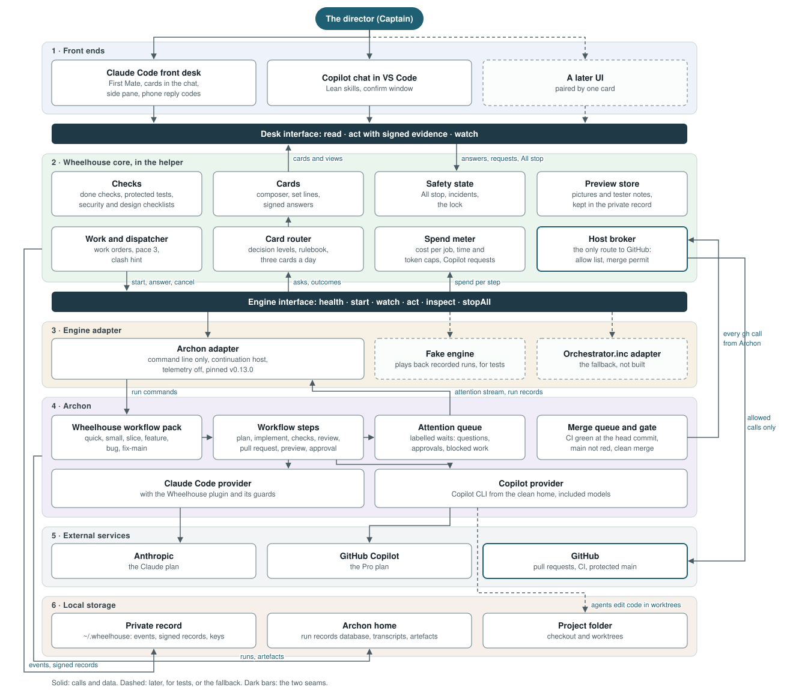
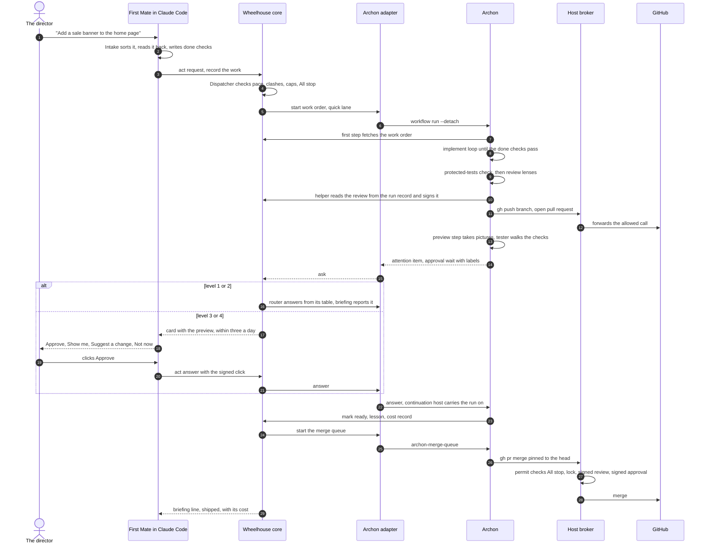

<!-- docs/specs/2026-10-29-wheelhouse-on-archon-design.md -->

# Wheelhouse on Archon: design

**Status:** draft for the director's approval, 29 October 2026. Nothing in it is built.

**What it changes.** Wheelhouse stops running its own build engine. Archon, an open-source workflow engine, runs the builds: sessions, worktrees, review loops, retries, the merge gate and merging. Wheelhouse becomes the director's seat on top of it. Where this design and `docs/specs/2026-10-17-wheelhouse-design.md` (the main design) or `docs/specs/2026-10-18-build-loop-design.md` (the build-loop design) differ, this one wins once approved. Section 4 says part by part what stays.

**Inputs** (the research is not redone here):

- the engine report and the side-by-side trial verdict of 29 October 2026 (kept privately), which picked Archon (33 of 45) over Orchestrator.inc (31 of 45), mostly on running cost (3 to 6 times less per job);
- the field, product-manager and squad reports of 29 October 2026 (kept privately), for the additions in section 11;
- the trial's notes, and a reading of Archon's source and documentation at tag v0.13.0 (commit `0d39c1f2`, 28 October 2026);
- the main design (its section 22 holds the director's past rulings), the build-loop design, `docs/specs/2026-10-20-other-agents-design.md` and `HANDOVER.md`.

**Marks.** *Designer's call* marks a choice the designer made, which the director may override; section 20 lists them. **Decided** marks what the director decided on 29 October 2026. Section 19 holds the one question that was the director's, and their ruling on it.

## 1. Intent

The director owns a product but isn't its developer. Wheelhouse lets them run AI agents that build it, while they spend their time on product decisions.

Wheelhouse built and maintains its own engine: the foreman (the Bosun), the watcher, feature sessions in worktrees, the round cap, retries, the gate and merging. That engine is the hardest part to keep working and the part least specific to Wheelhouse. Actively maintained open-source engines now do the same job. Archon's queues take work from a brief to a merged change through a gate much like Wheelhouse's. Archon also refuses to merge onto a failing main line, sends clashing changes back to be rebuilt, records the cost of each run, and raises one question with a recommendation when it's stuck.

So Wheelhouse keeps what no engine has: the First Mate and its cards in plain words, decision levels and the rulebook, signed approvals, the records and the Logbook, the safety hooks and All stop. It hands the building to Archon.

The director added one requirement for this redesign: **a UI can be built later without reworking the core.** So the design draws two seams. One lies between Wheelhouse's core and its front ends. The other lies between the core and the engine.

## 2. Goals, non-goals and anti-goals

**Goals.** These are the director's goals, each with how this design meets it.

| Goal | How this design meets it |
|---|---|
| A non-developer runs agents that build their product | The First Mate stays the one point of contact. Archon is installed, pinned and run by Wheelhouse, and the director never types an Archon command (sections 6 and 14) |
| At most about three cards a day, with previews rather than descriptions | Archon's attention items pass through decision levels before any becomes a card, under a daily card budget. Every card about something visible leads with a preview (sections 8 and 9) |
| It fits any project as it is, and is adopted gradually | Archon needs nothing in the project to start. One small policy file may be added later by a reviewed change (section 14.3). Wheelhouse moves to Archon one lane at a time, per project (sections 14 and 17) |
| Copilot ships in the first release, on a Pro plan of about $20 a month or less | Copilot runs as an Archon provider on the plan's included models by default. Wheelhouse counts premium requests and caps them, since Archon doesn't (sections 10 and 13) |
| Mac first, Windows later | The first release runs on the Mac. Windows follows once Archon's Windows issues are tried (section 16) |
| Low running cost | No foreman model sessions: a script dispatches the work. Archon's focused steps cost a third to a sixth of the alternative's. Each review lens runs only where a change touches its area (sections 7 and 10) |
| A UI can be built later without reworking the core | One small interface, the desk interface, serves every front end. The First Mate in Claude Code is its first client and Copilot's chat its second (section 5) |

**Non-goals**

- Building the UI now. The seam is built; the UI isn't.
- Using Archon's own console as the director's interface (section 5.6).
- GitLab in this release (**Decided**: lost for now; section 16).
- Windows in the first release.
- Writing Wheelhouse's own engine again if Archon fails. The fallback is another engine behind the same seam (section 6.5).

**Anti-goals** (failures even if everything technically works)

- The director sees Archon's words: run ids, node names, "attention item", YAML.
- An Archon answer, approval or merge happens without the director's signed click where one is needed.
- An agent reaches Archon's database, its credentials, another run's transcript, or Archon's command line.
- Archon sends usage data off the computer.
- Copilot spends money the director didn't agree to.
- Leaving Archon means touching anything beyond the engine adapter and the workflow pack.

## 3. The shape



*The architecture, in six layers.* The two dark bars are the seams: the desk interface between the front ends and the core, and the engine interface between the core and the engine. Every call to GitHub, from Wheelhouse or from Archon, goes through the host broker in the core. The diagram's file is `2026-10-29-wheelhouse-on-archon-architecture.svg`, beside this document.

- **The core lives in the helper,** the local Node.js process that already holds the keys, writes the private record and runs outside every agent's sandbox (main design, section 11). No new process is added. *Designer's call.*
- **The helper starts at sign-in,** not only at a session's start, so the dispatcher, the continuation host, the caps and the asks keep working while no Claude session is open. The start-at-sign-in route built for Copilot (`scripts/lib/login-start.js`) is reused, listed on setup's card of changes to this computer, and removed by uninstall. As today, work pauses while the computer sleeps and carries on when it wakes. *Designer's call.*
- **Front ends see only the desk interface.** They never read `~/.wheelhouse`, Archon or the host directly.
- **The core sees only the engine and host interfaces.** No module outside the engine adapter knows an Archon word (workflow, node, attention item, run id format, CLI flag), and no module outside the host adapter knows `gh`.
- **The tests cross the same seams.** A fake engine and the existing stand-in host run the whole core in tests, as the stand-in helper does today.

### 3.1 A request, from the director's words to a merged change

How a quick, visible change travels, and how its question comes back as a card. Numbers in the diagram are the order of the steps.



## 4. Part by part: keep, replace, repurpose, drop

Parts are named as the main design names them, with the crew name the director sees. "Archon" means Archon with Wheelhouse's workflow pack (section 7).

### 4.1 Director-facing

| Part | Decision | What happens |
|---|---|---|
| Front desk (**First Mate**), its playbook and command | **Keep** | It becomes a client of the desk interface: `scripts/frontdesk/cli.js` and the board-context hook call the desk instead of reading views themselves |
| Question cards (composer, set lines, reply codes, card check) | **Keep** | They gain two sources: asks from the engine (section 8) and preview cards (section 9). Composing stays in the core |
| Decision levels, delegation review, rulebook | **Keep** | They now also decide which engine asks are answered without a card (section 8.3) |
| Mod pane, buttons, courier, settings pane, `/wheelhouse-digest` | **Keep** | The bridge becomes a desk client, and the courier reads the desk's `watch` stream |
| Calm interface and its voice | **Keep** | Engine words are translated by the core before any front end sees them |
| Briefing and the Logbook | **Keep** | They read runs, asks and costs through the desk. The build tab shows each run's steps in plain words and its cost |
| Glossary, learning | **Keep** | |
| Notifications | **Keep** | |
| Setup | **Keep, rewrite** | It installs and pins Archon, Bun and (for Copilot projects) the Copilot CLI, with telemetry off (section 14) |
| Uninstall | **Keep, extend** | It also removes the engine's files, with a card for Archon's run history (section 14.5) |
| Settings and Thoroughness | **Keep** | Thoroughness columns become Archon tier and alias bindings per run (section 7.6). New settings: `cardsPerDay`, the spend caps, `engine` and `engineLanes` |
| Slash commands, terminal status line | **Keep** | |

### 4.2 Records

| Part | Decision | What happens |
|---|---|---|
| Private record, events, views, secret scan | **Keep** | New event kinds: `run`, `ask`, `cost`, `preview`, `lesson`. The record never goes to Archon |
| Signed records and keys | **Keep** | Reviews are signed from Archon's own run record, read by the helper (section 7.5). Client keys extend the signing to future front ends (section 5.3) |
| Lock and fencing counter | **Keep** | The broker checks the lock before every merge or push (section 12.4) |
| Personal settings, v0.1.x import, pending records | **Keep** | |
| Usage receiver and store | **Keep** | It still measures the front desk's sessions. Runs are measured from Archon's record (section 10) |
| Feature records (`feature`, `report`, `dispatch`, `gate-asks`) | **Repurpose** | They become `run` and `ask` records, keyed by the work and the engine's run |
| Product documents (section 24, part 3) | **Keep, unchanged plan** | Not needed for this redesign. Rulings reach runs through the work order (section 7.4) until part 3 ships |

### 4.3 Safety

| Part | Decision | What happens |
|---|---|---|
| Hooks: session start, stop word, context gauge, board context, STOP guard, lineage hold, tool guard, card check, prompt record, PreCompact guard | **Keep** | Every Claude node in Wheelhouse's pack loads the Wheelhouse plugin, so the guards fire inside Archon's runs (section 12.1) |
| Hook: feature status | **Drop** | Archon's run record holds a run's status |
| Hook: report check | **Repurpose** | The helper signs reviews from Archon's run record instead (section 7.5) |
| Tool guard | **Keep, extend** | It also refuses `archon` and Archon's home folder to agents (section 12.2) |
| Protected tests | **New** | A hook and a check step (section 11) |
| Sandbox, deny rules, Standard and Locked | **Keep** | Extended to deny Archon's database, credentials and transcripts (section 12.2) |
| All stop and the runbook | **Keep, extend** | All stop cancels every run through the engine, and the runbook gains that step (section 12.3) |
| Guardrails | **Keep, extend** | `.archon/**` and Wheelhouse's workflow pack become guardrails |
| Merge gate | **Replace, keeping a permit** | Archon's gate checks CI on the exact head, a clean merge and a main line that isn't red. Wheelhouse's broker refuses a merge without its permit: All stop off, the lock held, no incident open, a signed CLEAN review and, where needed, the director's signed approval (section 12.4) |
| Screenshot compare (approval carried over an update) | **Keep** | It runs inside the permit check |
| Incident freeze | **Keep** | The dispatcher starts nothing and the broker merges only the fix |
| Agent control-file watch | **Repurpose** | It runs as a check step before each review |
| Bypass-mode markers | **Drop** | Archon starts Claude in its bypass mode, so the guards stand on hooks, deny rules and the sandbox (section 12.1) |
| Safe-git fence, health trials, server-side protection, secret handling | **Keep** | |

### 4.4 Build engine

| Part | Decision | What happens |
|---|---|---|
| Intake and lanes (quick, small, feature, bug) | **Keep** | The First Mate still sorts and sizes the work. Each lane becomes one workflow in the pack (section 7.2) |
| Show before build, ideas, rejections | **Keep** | |
| Foreman (**Bosun**), its playbook and wake scripts | **Replace** | A deterministic dispatcher in the core starts runs, and Archon's workflows do the rest. No model session runs the build (section 7.3). The Bosun's name stays for the director, as the part of the Logbook that shows the build |
| Queue, pace, clash check | **Repurpose** | They move into the dispatcher. Pace stays at three. The clash check becomes a hint for ordering, and a real clash is caught and sent back by Archon's merge gate (section 7.7) |
| Watcher, waker, Shape 1 and Shape 2 | **Replace** | Archon runs the work, and the engine adapter's continuation host keeps paused runs moving (section 6.3) |
| Feature sessions, worktrees, the four feature files, feature commands | **Replace** | Archon's runs, worktrees and artefacts take their place |
| Brief, done contract, appetite | **Repurpose** | They become the work order (section 7.4), with "done" written as checks a script can run |
| The Wheelhouse override on Superpowers | **Repurpose** | It shrinks to the rules each node's prompt carries (levels, rulings, never merge, take the blocked exit rather than ask). Archon now holds the order of the steps, which the override existed to enforce. The method skills steps use become pinned, adapted copies in the Wheelhouse plugin (section 7.1) |
| Builder, reviewer and tester agents | **Repurpose** | Their instructions become the prompts of the pack's nodes |
| Round cap, retries | **Replace** | Archon's `max_iterations` on every loop and its retries. Only BLOCKER and HIGH findings hold work back, as decided on 24 October 2026 |
| Merging, CI watching, mergeability checks | **Replace** | Archon's merge queue, behind the broker's permit |
| Provenance | **Keep, extend** | It also names Archon's version and the pack's digest |
| Lineage: manifest, register, hold, monthly upgrade, undo | **Keep, extend** | Archon, Bun, the Copilot CLI and the pack join the pins (section 16) |
| Routing table | **Keep** | It stays the only place that names a model. The engine adapter turns it into tier bindings per run |

### 4.5 Host

| Part | Decision | What happens |
|---|---|---|
| Host adapter (`gh`) | **Keep** | |
| Host adapter (`glab`) | **Keep, unused** | GitLab is lost while Archon can't open or merge GitLab merge requests. The code stays for the old engine's last release and is then retired (section 17) |
| Helper and its routes | **Keep** | It gains the desk interface, the engine adapter and the broker. The foreman's routes go |
| Mirror and test merge | **Drop** | Archon's gate checks mergeability |
| Quick and narrow connections, the GitHub App, company certificates, cut-access | **Keep** | |
| The rule that only the helper talks to the host | **Kept, by a broker** (**Decided** 29 October 2026, section 19) | Archon's `gh` is a Wheelhouse broker that forwards allowed calls through the helper (section 12.4) |

### 4.6 Other agents (Copilot)

| Part | Decision | What happens |
|---|---|---|
| The adapter seam (`scripts/agents/contract.js`) | **Repurpose** | Its session parts (`sessions`, the waker's calls) go. Hook translation, tool sheets, card words and settings stay, now serving the front ends and the Copilot CLI's own hooks |
| Claude Code adapter | **Repurpose** | Same: it keeps what a front end and the hooks need |
| Lean (Copilot with no helper) | **Keep** | It never ran builds. It becomes a front end with no engine: intake, ideas, rulings and designs, as today |
| Middle and Full (background builders on Copilot) | **Replace** | Archon runs Copilot as a provider |
| Clean home | **Repurpose** | It becomes the home the Copilot CLI runs in under Archon, with Wheelhouse's guards registered (section 13) |
| Permission levels | **Repurpose** | They become each Copilot node's tool rules |
| Background sessions switch | **Drop** | Replaced by the early check and the engine setting |
| Copilot signed review (clean session) | **Replace** | A review node on the Copilot provider, signed by the helper from Archon's record |
| Confirm window | **Keep** | It is the Copilot front end's way to sign (section 5.3) |
| Copilot plugin and kits | **Keep** | They serve the Copilot front end |
| Copilot evaluation (scenarios 38 to 41) | **Keep, retarget** | It runs against Copilot nodes under Archon |

### 4.7 Evaluation and the rest

| Part | Decision | What happens |
|---|---|---|
| Evaluation runner, scenarios, column readiness | **Keep, retarget** | The build-loop scenarios (20 to 35) are rewritten against the pack. They run with the fake engine in tests and with real Archon in the counted evaluation (section 18) |
| Survey and project under way | **Keep** | Work carried on starts as a run from the ready-made change |
| Weekly jobs, the official-sources check | **Keep, extend** | It also watches Archon's releases and advisories |
| Premium opt-in, usage nudge | **Keep** | |
| Context and compaction | **Keep** for the front desk | Nodes start with fresh context |

## 5. The desk interface: the core and its front ends

### 5.1 Why a seam here

Today the front desk's command, the board-context hook, the mod's bridge and the courier each read the core in their own way. A future UI would add a fifth way. Instead, every front end uses one interface. The two front ends already planned for the first release, Claude Code and Copilot's chat, are two real adapters, so the seam is real now and doesn't wait for the UI. *Designer's call.*

### 5.2 The interface

Three operations, each over a versioned vocabulary (`desk/1`):

| Operation | What it does | Vocabulary |
|---|---|---|
| `read(view, args)` | Returns a view as data, already in the director's words | `glance`, `briefing`, `logbook` (tab), `waiting`, `card` (id), `work`, `settings`, `usage`, `preview` (card id), `why` (card id), `survey` |
| `act(command, args, evidence)` | Changes something. Returns what changed, or a refusal in plain words | `answer` (card, option), `suggest` (card, words), `not-now` (card), `request` (words), `set` (setting, value), `all-stop`, `lift-all-stop` (`all-stop` needs no evidence, as the stop word needs none today), `pair` (client) |
| `watch(cursor)` | A resumable stream of changes, delivered at least once | `card-added`, `card-closed`, `glance-changed`, `work-changed`, `all-stop`, `notice` |

What a caller must know beyond the names:

- **Views are finished.** They are built by the core in Calm's voice, through the glossary, so no front end composes words of its own. A UI draws them, and the First Mate reads them out. *Designer's call.*
- **Every `act` that decides or steers something needs evidence** (section 5.3). Without it, `act` refuses. `suggest` needs it too, since its words can reach a waiting run as an answer (section 8.4); the pane's press and the chat's typed words are signed as they are today. Only `request`, `not-now` and `all-stop` need none: a request is queued for the First Mate, putting a card off decides nothing, and stopping must always be easy.
- **A stale act is refused, not applied.** An answer names the card's hash, as a pane press does today. An answer to a card that closed or changed meanwhile is refused with the line saying which answer counted.
- **Requests typed into a front end without a First Mate** (a later UI) are queued for the First Mate's next turn and shown as waiting. Intake stays a model's judgement, inside the First Mate.

### 5.3 Trust: who may decide

The core accepts a decision only with evidence that the director made it:

- **Claude Code:** the prompt-record hook's signature on a card click, a reply code or a pane press, as today (main design, section 12.5).
- **Copilot:** the confirm window's signature (other-agents design, section 6.3).
- **A later UI:** its own client key. The key is made when the UI is first opened, and enrolled by the director's click on a **Pair this app** card in an existing front end. It is kept where no agent can read it (the sandbox already denies `~/.wheelhouse` and the keychain). One click unpairs it.

The core keeps the list of paired clients beside this computer's own key. Agents can reach the helper's socket, as they can today, but they hold no client key, so they can read views and never decide. *Designer's call.*

### 5.4 Transport

The desk runs on the helper's existing local socket (a named pipe on Windows), as JSON messages. A local web address, bound to the computer itself only, is added when a UI is built, not before. *Designer's call*, following the rule that a seam's second transport comes with its second user.

### 5.5 The Claude Code front end, as a client

- The First Mate's playbook, the intake and the card rules are unchanged.
- `scripts/frontdesk/cli.js` keeps its commands and calls `read` and `act` underneath. The board-context hook calls `read('briefing')` and `read('waiting')`.
- The bridge calls `read('glance')` for the pane and `act` for presses. The courier follows `watch`.
- The build plan's first part moves these calls behind one client module, `scripts/desk/client.js`, with no change the director can see. That part can ship before Archon (section 17).

### 5.6 Archon's console: weighed and not used

Archon has a web console (`archon serve`): runs, a node graph, artefacts, a "Needs your input" list, browser push, and about 60 HTTP routes with an OpenAPI description. It is tempting as a ready-made UI.

**Not as the director's interface, and not run by default.** *Designer's call*, for four reasons:

1. **It is open by default.** It binds every network interface (`0.0.0.0`) on port 3090, with no sign-in and any origin allowed. On a café's wi-fi, anyone could approve a run. Archon's own sign-in needs a PostgreSQL database.
2. **It answers past Wheelhouse.** An answer given there reaches Archon with no signed record, no decision level and no rulebook check. The broker would still refuse an unsigned merge, but a scope question answered there would never reach the record.
3. **It speaks an engineer's language:** runs, nodes, transcripts and workflow YAML.
4. **It ties a UI to one engine.** A UI built on the desk outlives a move off Archon.

What Wheelhouse uses instead: Archon's command line, run by the engine adapter, which needs no server (section 6.3). For a developer who wants to look inside, an advanced setting, **Engine room**, starts `archon serve` bound to the computer itself only (`HOST=127.0.0.1`). It is off by default, it is shown on the Logbook while it is on, and the sandbox denies its port to agents. A later UI may link to it for technical directors, read-only in spirit.

## 6. The engine interface and the Archon adapter

### 6.1 The interface

| Operation | What it does |
|---|---|
| `health()` | Is the engine installed at the pinned version, with its runtime, its providers and telemetry off? Returns plain findings for the Logbook |
| `start(order)` | Starts one piece of work from a work order (section 7.4). Returns the run's id |
| `watch(cursor)` | A resumable stream of normalised events: `run-started`, `step-finished` (with its spend), `ask`, `ask-resolved`, `run-ended` (outcome, branch, pull request) |
| `act(run, command)` | `answer` (ask, choice, words), `cancel` (reason), `resume` |
| `inspect(run)` | The run's record: status, steps, each step's role, provider, model, tokens, cost, minutes, branch and pull request |
| `stopAll(reason)` | Cancels every run for All stop |

What a caller must know:

- **Asks are normalised.** An ask has an id (stable across restarts), a kind (`question`, `approval`, `blocked`, `usage-limit`, `trouble`), the labels Wheelhouse's pack wrote, the options, and the run's context. Section 8 says how they become cards.
- **Spend comes with each step,** marked as reported, estimated or unknown. Unknown is never zero (section 10).
- **Answers are idempotent.** A second answer to the same ask, or one to an ask that moved on, is refused, never applied twice.
- **The engine never holds the director's authority.** The core answers an ask only after the signed record exists (section 8.4).

### 6.2 Why this is deep

The adapter hides the workflow pack, Archon's command-line flags and JSON shapes, the environment it must run with (telemetry off, `ARCHON_HOME`, the `PATH` with Bun and the `gh` broker), the version pin and its checksums, `archon provider add`, the continuation host, the attention stream's cursor, where Archon keeps its records, and the mapping from the routing table to tiers. Delete it, and every one of those leaks into the dispatcher, the card router, the spend meter, All stop and the Logbook. It has two adapters from the start: Archon, and a fake used by every test and by the evaluation's stand-in.

### 6.3 The Archon adapter

- **Command line only, no server.** Runs start with `archon workflow run <workflow> --detach`, which returns the run's id as JSON. Asks come from `archon workflow attention --watch --json --after <cursor>`, which is resumable and delivered at least once. Answers go through `archon workflow answer --json`, records come from `archon workflow get --json --verbose`, and `cancel`, `resume` and `abandon` work the same way.
- **The continuation host.** An answered run stays paused until a host carries it on. The helper supervises one `archon workflow wake --watch` process and one attention stream, and restarts either if it stops, as it starts the usage receiver today. The cursor is kept in the private record, so a restart misses nothing. This replaces the watcher.
- **Every call has the same environment.** It sets `ARCHON_HOME`, `ARCHON_TELEMETRY_DISABLED=1`, `DO_NOT_TRACK=1` and `POSTHOG_API_KEY=off`, a `PATH` that has the pinned Bun and the `gh` broker but not the real `gh`, and `CLAUDE_BIN_PATH` and, for Copilot, `COPILOT_BIN_PATH`. No Archon command runs any other way: the trial found one run with telemetry on, from a command run before the setting reached the shell.
- **The workflow source is pinned.** Runs pass `--workflow-source` with the installed pack, and Archon records the source's digest in each run. The helper checks the digest before it trusts a run's review or its outcome.
- **Configuration stays out of the project.** The adapter passes `--config` with Wheelhouse's own file, so the project needs nothing committed to start using Archon. The one exception, the merge queue's policy file, is in section 14.3. Worktrees are placed inside the project folder (`worktree.path`), where the agents' sandbox already lets them work.

### 6.4 Where Archon keeps its records

`ARCHON_HOME` is a Wheelhouse folder outside `~/.wheelhouse`, so that agents can use their run's artefacts there. Archon fixes the layout under it: `workspaces/<project>/` holds `artifacts/runs/<run>/`, `logs/` (the transcripts), `workflow-source/` and, unless moved, `worktrees/`. So the rule is path by path. The sandbox and the tool guard deny agents the database (`archon.db` and its journal files), `credential-key`, `.env`, `config.yaml`, `plugins/`, every `logs/` and `workflow-source/` folder, and every run's artefacts but their own. An agent can read and write its own run's worktree and artefacts, and nothing else of Archon's. How the sandbox is told which run is its own (a per-run settings overlay, or Archon's per-node `sandbox` setting) is left to the builder. Early check E2 tries it. *Designer's call.*

### 6.5 The fallback: Orchestrator.inc

If Archon fails, Wheelhouse moves to Orchestrator.inc (Apache-2.0, 62 contributors, native Copilot). What changes:

- A new adapter behind the same interface. Orchestrator.inc runs a local daemon over HTTP, so `start`, `watch`, `act` and `inspect` map to its calls.
- A new "pack": its worker and reviewer roles, with Wheelhouse's prompts.
- **The gate comes back to Wheelhouse.** Orchestrator.inc's merge is one call with no gate, so the broker's permit would grow to the full gate the helper has today (`scripts/gate/conditions.js`). That code is kept in the repository for this reason until Archon has held for three months. *Designer's call.*
- **Spend:** its cost records skip Copilot, as Archon's do, so the spend meter's estimate carries over unchanged.

Nothing else in the core changes. A one-page note in the repository keeps this mapping current at each monthly upgrade.

## 7. Work through the engine

### 7.1 How a node uses skills

**How Archon loads them** (confirmed from Archon's workflow language at v0.13.0):

- An AI node runs Claude Code through its Agent SDK, with the project's and user's `.claude` settings loaded by default.
- **Plugins are off unless the node names them,** and the node fails if an unnamed plugin loads. **Skills are an exact allowlist per node.** A plugin's skill is named with the plugin's prefix (`wheelhouse:tdd`) and needs the plugin named too. A skill name Archon doesn't recognise only warns, and the step runs without it.
- **Every Claude node in the pack names the Wheelhouse plugin,** so the guards load (section 12.1).
- A step starts with only the names and one-line descriptions of its allowed skills. The full skill is read when the agent opens it, and its extra files only if it follows a link to them. In a loop with fresh context, each round is a new session, so a skill opened every round is read every round.
- On the Copilot provider, skills work but plugins and hooks don't. Copilot nodes read Wheelhouse's skills from the clean home (section 13).

**What it costs.** The research of 29 October 2026 (kept privately) measured the skills against the small lane's worst case, a 30-round implement loop that reopens its TDD skill every round. Matt Pocock's `tdd` costs about 1% of the lane's 4 million token cap, and Superpowers' TDD skill with its start-up hook about 2.5%. On Copilot, length costs nothing, since its plan counts prompts sent, not tokens. The real cost is behaviour: a skill that waits for a person, spawns helpers, or runs the whole test suite every round costs far more than its length. So the verdicts below turn on behaviour.

**No one has shown this working in public.** Archon's own pack names no skills in `skills:` or `plugins:` in any shipped workflow. Its maintainer writes the method into each step's prompt, and names a skill only in the prompt's words, so the workflow still runs on a provider that can't load skills. Using real skill files inside steps is Wheelhouse's step beyond that. It rests on early check E4 (section 15), which compares a skill against the same rules written into the prompt.

#### Which skill runs where

**Method skills are kept and orchestrating skills are replaced** (**Decided**). Every Superpowers and Matt Pocock skill, judged on that rule. *Designer's call* for each verdict, from the research.

| Skill | Verdict | Step | What changes, and why |
|---|---|---|---|
| Matt Pocock's `tdd` | **Adapt** | Every implement loop, in every lane | The one TDD skill. It is small, and runs the full suite once at the end, not every cycle, which suits loops. Its "confirm the seams with the user" becomes: take the seams from the work order or the plan's task, or record them as an assumption. It calls `codebase-design` when the shape is unclear, so both go on the same allowlist |
| Matt Pocock's `codebase-design` | **Use** | Plan step; on every implement loop's allowlist beside `tdd` | Shared words for a module's shape. A reference, not a conversation. Rarely opened inside a loop, so cheap there |
| Matt Pocock's `diagnosing-bugs` | **Use** | The bug lane's reproduce step | The one debugging skill. Its first phase ends with one command that goes red on the bug, which becomes the loop's done check (`until_bash`). "No reproduction can be built" becomes the blocked exit |
| Superpowers' `test-driven-development` and `systematic-debugging` | **Fallback** | Only if E4 shows them working better than the pair above | Kept as copies, not named in any step. Two TDD skills in one pack would give lanes different rules on when to refactor and how often to run the suite. If brought in, `test-driven-development` needs the loop rules below, since it runs the whole suite before calling any change done and tells the agent to delete code written before a test |
| Superpowers' `writing-plans` | **Adapt** | Plan step (small, slice) | Read once a run, so cheap. Adapted copy: it saves where the work order says, its plan header has no line naming `subagent-driven-development`, it skips the hand-off to a person, and it returns the plan as the step's output. Otherwise the loop's builder reads "use subagent-driven-development" in round one |
| Superpowers' `verification-before-completion` | **Use** | Implement, fix and test steps | Small, and stops a "done" claim without evidence. Archon's `until_bash` enforces this for the loop, and the skill holds the step's written report to it too |
| Matt Pocock's `code-review` | **Adapt**, into two lenses | Two parallel review steps in the graph: **standards** and **spec** | As written it spawns two parallel helpers and needs a setup file (`docs/agents/issue-tracker.md`). Its two halves become two review steps side by side. The fixed point is the base branch, and the spec is the work order. **Standards** checks the change against the repository's documented standards and the skill's fixed list of code smells. **Spec** checks it against the work order's goal, scope and done checks. Same result, no helpers, no setup file. Both are review steps as in section 7.5, signed the same way |
| Superpowers' `requesting-code-review` | **Drop** | | It spawns a reviewer helper, and Archon's review step already is the fresh reviewer. Its reviewer template is reused as text in the review steps' prompts |
| Superpowers' `receiving-code-review` | **Adapt** | The fix loop | Acting on findings with care: check before changing, push back on a wrong finding. Its "ask when unclear" becomes: record the disagreement in the step's output, and the reviewer checks it again next round |
| Matt Pocock's `pr` | **Adapt** | The pull request step | A short template: summary, evidence before and after, the danger in merging. Adapted to keep every private record out, since repositories may be public (section 10.1) |
| Matt Pocock's `prototype` | **First Mate** | The feature lane's design stage | Its point is a person clicking through an idea before the design is approved, so it belongs with the director, not in a step. A user-level skill of the same name may exist, so the First Mate names it in full |
| Superpowers' `brainstorming`; Matt Pocock's `grilling`, `grill-me`, `grill-with-docs`, `domain-modeling`, `to-spec`, `to-tickets`, `wizard` | **First Mate** | Intake, design and slicing, with the director | Conversations with a person. `domain-modeling` builds the glossary that steps read. `to-tickets`' rules for vertical slices are borrowed when the First Mate slices a feature |
| The design skills the director uses: `emil-design-eng` (Emil Kowalski's), `apple-design`, and the taste skill | **Use** | The design lens only | The largest skills in play (about 6,800 and 5,800 tokens for the first two). Fine in the one design-lens step. **Never inside an implement loop,** where they would be read every round: there, a few lines in the prompt point at the style guide instead |
| `frontend-design` | **Use** | The design lens; the implement loop on visible work | Light enough to sit in the loop |
| Superpowers' `using-superpowers` | **Avoid** | Never loaded | It tells an agent to invoke skills on "even a 1% chance" and to brainstorm before building, which is wrong in a step allowed one skill. It arrives through the Superpowers plugin's start-up hook whether named or not (see packaging, below) |

**Dropped, because Archon's graph or Wheelhouse does the job:**

- **They orchestrate:** Superpowers' `subagent-driven-development`, `executing-plans`, `dispatching-parallel-agents` (Archon's loop groups and parallel steps), `using-git-worktrees` (Archon gives every run its own worktree, and two tools making worktrees would clash) and `finishing-a-development-branch` (the broker and the merge queue). Matt Pocock's `implement` and `implement-spec` (the graph's order), `wayfinder` and `triage` (Wheelhouse's intake and dispatcher), `research` (a step can't usefully wait on its own background agent), and `setup-matt-pocock-skills` and `ask-matt` (needed only by skills dropped or adapted away). The Wheelhouse override's ordering rules go the same way.
- **They are for maintaining Wheelhouse, not building the product:** Superpowers' `writing-skills` and `diagnosing-superpowers`; Matt Pocock's `writing-for-agents`.
- **They are conversations, or are covered elsewhere:** Matt Pocock's `improve-codebase-architecture`, `teach`, `to-questionnaire` and `wait-what` (conversations with a person); `retro` and `handoff` (the lesson step and Archon's step outputs).

Matt Pocock's skills that only a typed `/name` can start are all among the dropped or First Mate ones, so nothing in a step depends on a `/` prompt working.

#### Packaging: copies in Wheelhouse's own plugin

- **The kept skills are copied into the Wheelhouse plugin** under their plain names (`tdd`, `codebase-design`, `diagnosing-bugs`, `writing-plans`, `verification-before-completion`, `receiving-code-review`, `pr`, and the two review lenses), with the adaptations above made in the copies. Both sources are MIT licensed. Each copy keeps its licence and notes where it came from and at which version. The design skills are copied the same way, for the design lens.
- **Their versions are pinned and upgraded on purpose,** with the monthly upgrade check: a new upstream version is read, the adaptations are carried over, and the counted evaluation runs before the pin moves. Upstream changes often and in big steps.
- **No node names the Superpowers plugin.** Naming a plugin brings its hooks and agents as well as its skills, and Superpowers' start-up hook pastes `using-superpowers` (about 900 tokens) into every step that loads it. Steps name only Wheelhouse:

  ```yaml
  plugins: [wheelhouse@wheelhouse]
  skills: [wheelhouse:tdd, wheelhouse:codebase-design, wheelhouse:verification-before-completion]
  ```

- **The same names on Copilot.** The clean home holds the same copies (section 13). A Claude step names `wheelhouse:tdd` and a Copilot step names `tdd`; the skill and its words are the same. The pack's source names each skill once, and its build writes the two forms. *Designer's call*; if E4 shows a plain name finds a plugin's skill, the two forms become one.
- **The pack's own check refuses a skill name that matches no copy,** since Archon only warns and the step would run without its method. It runs with the check that every Claude node names Wheelhouse (section 12.1).

#### Prompts in steps that use skills

- **No person in a step.** Every adapted skill's "ask your human partner" or "confirm with the user" becomes: decide within the rules and record an assumption in the step's output, or take the blocked exit (section 7.2). A step never waits for an answer, which would sit until Archon's idle timeout.
- **Loop prompts say that earlier rounds' committed code stands,** so a strict TDD rule never reads round one's work as "code before a test" and deletes it, and that **the full suite runs once, at the end,** with only the tests in focus during the rounds.
- **Steps name their skills in the prompt's words,** as Archon's own pack does ("follow the tdd skill: a failing test first"), so a step degrades gently if a skill fails to load, and so the words match on both providers.

### 7.2 Lanes become workflows

The pack (`engine/archon/pack/` in Wheelhouse's repository) holds one workflow per lane. Each builds on Archon's node types. The step lists below are the design. The YAML is left to the builder.

| Lane | Workflow | Steps |
|---|---|---|
| Quick | `wheelhouse-quick` | read the work order; implement with `tdd`, as a loop until the done checks pass (`until_bash`, at most 5 rounds); protected-tests check; review (the standards and spec lenses side by side, and the others that apply); push and open the pull request through the broker, its text written with `pr`; preview of its head, if the change is visible; approval wait, if the work is shown first; mark ready for the merge queue; lesson |
| Small | `wheelhouse-small` | read the work order; plan (`writing-plans`' method, in the plan step's prompt, with `codebase-design`), committed as `.wheelhouse-plan.md` and skipped on a rerun that finds it; one task block a task, inside the run and one at a time, each implementing its task with `tdd` and closing when the task is ticked, committed and its test passes, in at most 2 rounds; at most 8 tasks (more goes to the feature lane as slices); one question once every task has settled, if any blocked; protected-tests check, with one repair step; the plan taken out of the branch; whole-change review with its lenses, standards and spec among them; fix rounds (`receiving-code-review`'s method, in the fix step's prompt), at most 3, each rerunning standards, spec and the lenses that held, closing only on BLOCKER and HIGH; pull request; preview of its head; approval wait, if shown first; mark ready; lesson |
| Feature slice | `wheelhouse-slice` | as small, plus a task review inside the loop, the tester's walk of the done checks in a real browser, and the critical-area review on the most capable model |
| Feature | `wheelhouse-feature` | one child run of `wheelhouse-slice` per slice, in the slice order the approved design gives, each merging behind its feature flag; a whole-feature review; a midpoint demo wait, where the director chose midpoint demos; the switch-on wait |
| Bug | `wheelhouse-bug` | reproduce with `diagnosing-bugs`' method, in the reproduce step's prompt: the failing test committed on its own; a red step proves it fails at that commit, which holds only the test, and the helper keeps it once for the work from the engine's record and adds it to the order's done checks, so a rerun keeps it; a build loop of at most 5 rounds that closes only when every done check passes with the reproduction's test unchanged; a size rule (more than 5 product files, or the checks still failing) and the reproduce step's own judgement take the blocked exit with a proposal (a small change, a feature, or Stop), and a lane chosen goes back to the First Mate to record again; then the quick lane's steps from the protected-tests check on |
| Fix main | `wheelhouse-fix-main` | started by the dispatcher when the main line goes red (section 11) |
| Merge | Archon's `archon-merge-queue` | used as Archon ships it, with the broker as its `gh` (section 12.4) |

- The feature lane's pitch, preview and design stay with the First Mate and the director, as today (main design, section 7.4). Archon starts once the design is approved.
- **"Shown first"** is the work record's flag (main design, section 7.3): visible work, unless the director waived it. The pull request is opened before the preview, so the preview and the approval both name its head commit, as the approval's set line needs.
- **A "blocked" exit on every builder step.** Each AI step's structured output has a `blocked` field (the question, the options and the recommendation). A `when:` sends a blocked step to a wait instead of the next step.
- **Steps settle levels 1 and 2 themselves.** Each step's prompt carries the decision rules (section 7.4): a reversible choice within the rules is made, recorded as an assumption in the step's output and reported, as builders do today (main design, section 7.5). Only a level-3 or level-4 question becomes a blocked exit. So no model is needed between runs to answer small questions.
- **A task ends only when it truly ended.** A task's loop closes on its last round whatever the reason, so the lane's close looks again at every ticked task: its test passes, the tree is clean, and its review doesn't hold. A task that didn't end is unticked in its own commit, and the close raises one card with **Send it back for a fresh run** recommended, so the fresh run builds it again.
- **A held review outlives its run.** A run cancelled before its close (All stop, a cap's Stop, or a cancel in the engine) never reaches that look, and the next run skips a ticked task. So for a slice the helper keeps what each run's task reviews last said, in its own record, read from Archon's record of the run when it ends, however it ended, and never from anything a step hands in or from the run's artefacts. The next run's close asks the helper for the tasks whose latest review holds, across every run of that slice, and treats each as not ended. Only a later review of the task answers a hold. Holds the helper can't give count as red. *Designer's call.*
- **Reuse Archon's own workflows where they fit.** The pack may run `archon-implement` or `archon-review` as child workflows where they match, rather than copying them. The builder chooses per step, and the counted evaluation decides. *Designer's call.*

### 7.3 The dispatcher

The Bosun was a model session woken in batches. The dispatcher is a script in the core:

- It takes work records in the order the First Mate gave them, and starts at most `pace` runs at once (three by default, one of them in the feature lane). A feature counts as one: its slices run one after another as child runs. The merge queue's run is on top, so Archon never has more than `pace` + 2 runs going.
- It holds back work whose files overlap a running piece's (the clash check, as a hint).
- It starts nothing under All stop or an open incident, or while a spend cap is reached (section 10).
- It starts Archon's merge queue (`archon-merge-queue`) from the command line, never by Archon's triggers (which want its server), when a lane run ends with a pull request ready, on the first tick after a ruling to merge, and again every 15 minutes while any wait. **One merge-queue run a project is live at a time.** Archon's own ruling step may also start one, which the helper isn't told of, so before any start the helper asks the engine what is live in the project's queue folder. A live run the helper didn't start takes the place of its start: the helper follows that run's asks, and a ruling still due starts the queue once it ends. If the engine can't say, nothing starts on that tick. The lanes' "mark ready" step only tells the core. The queue looks at every open pull request, but merges only one carrying the verdict comment the helper posts (section 7.5), and the broker's permit refuses any other, so a pull request the director opened by hand is never merged by it.
- It re-queues a pull request that Archon's merge gate sent back for a clash (section 7.7).
- It never decides anything a model would. Judgement lives in the workflows' steps and in the First Mate.

Keeping pace at three also keeps Archon below the six to eight runs at once at which its SQLite database has locked up in the field. *Designer's call.*

### 7.4 The work order

The core writes one work order per run, replacing the brief. Its contents:

- the goal, and what's not in scope;
- **"done" as checks** (section 11): each check is a test name, a command with its expected result, or a page and what must be true on it;
- the rulings that apply (from the rulebook, until section 24's part 3 moves them to `docs/wheelhouse/rulings.md`);
- the decision rules: what is level 3 or 4 and must become a blocked exit;
- the caps (section 10) and the files the protected-tests check may let change;
- the preview pages and the style guide's path, for visible work;
- the role's model bindings from the routing table, in force for this run.

The order is written to the run's artefacts by the run's first step, which asks the helper for it, so the director's words never pass through Archon's command line or its database. *Designer's call.*

**That copy is for reading only.** An agent can write its run's artefacts, so nothing that guards reads its rules from there: the protected-tests guard and check, the caps and the done check ask the helper for the run's order by the run's id. A changed copy changes nothing. *Designer's call.*

### 7.5 Reviews, and how they are signed

- Review steps are fresh nodes with no write tools (`denied_tools`) and read-only Bash, as the reviewer agent is today. Each returns findings as structured output: severity, file, line, a repro and a fix.
- **The helper signs a review by reading Archon's record,** never from a file an agent could write. After a review step, a step asks the helper to record it. The helper reads that step's output from `archon workflow get`, checks the run's pack digest and the step's identity, and signs a `review` event naming the head commit. Agents can't reach Archon's database (section 6.4), so they can't plant a review. *Designer's call.*
- **The merge queue's verdict comes from that signature.** Once a CLEAN review is signed, the helper posts the review-verdict comment Archon's merge queue reads, for that head, under the identity its policy trusts (section 14.3). The comment's form is the one the pinned release's gate script reads. Each monthly upgrade's evaluation checks it still counts, since the form may change between releases. No step posts a verdict itself, and the broker refuses one that tries (section 12.4). *Designer's call*, chosen over running Archon's own multi-lens review, which costs more tokens and doesn't sign.

### 7.6 Models

- The routing table stays the one place that names a model (main design, section 8). The engine adapter turns the column in force into Archon bindings per run (`--model large=…`, and the pack's aliases such as `@implementer`). Nothing in the pack names a model.
- Copilot projects have their own column, which defaults to Copilot's included models (section 10).

### 7.7 Clashes and a red main line

- **A red main line:** Archon's merge gate refuses to merge while the default branch's CI is red, and raises one ask whose only choice is to hold. The card router answers it itself (level 1, section 8.3), the Logbook shows a line, and the dispatcher starts `wheelhouse-fix-main`, since code changes that make CI pass are level 1 (main design, section 6).
- **A clash:** the merge gate sends a pull request that no longer merges cleanly back. The dispatcher starts the same lane again on the same branch with "bring it up to date" in the order. The run merges the main line in, runs the checks again, and asks for a new review only if its own changes moved. A second clash on the same work raises a level-3 card.

## 8. Asks become cards

### 8.1 Where asks come from

| Source | Example | Kind |
|---|---|---|
| A wait in Wheelhouse's pack | approval of a visible change; a slice's midpoint demo; a builder's blocked exit | `approval`, `question`, `blocked` |
| A wait in Archon's own workflows | merge queue: main line red (`hold`); rounds ended without a ready review (`rerun` or `finish`); a schema or permissions change the queue won't judge | `question` |
| Archon itself | a provider's usage limit (resumes on its own); a step with no progress for 30 minutes | `usage-limit`, `trouble` |
| The core's caps | a run reached its time or token cap | `blocked` |

### 8.2 The labels Wheelhouse's pack writes

Each wait in the pack carries labels: `wh.kind`, `wh.level`, `wh.topic` (the delegation slug), `wh.work`, `wh.recommend`, `wh.preview` (the artefacts folder, for visible work) and the set line's material (pull request and head commit, for approvals). Labels are Archon's own routing field, so no Archon change is needed.

### 8.3 The card router

The core's card router reads each new ask:

1. **Normalise.** Asks from the pack carry their labels. Archon's own asks are mapped by a fixed table, kept in the engine adapter: `hold` on a red main line is level 1, ended rounds are level 3 (the "failed three times" trigger), a schema or permissions change is level 3, and a usage limit is no card at all, only a Logbook line. An ask nobody recognises becomes a level-3 card recommending that the work stop, with the reason in plain words.
2. **Decide by level.** The asks that reach the router at levels 1 and 2 are Archon's own, from the fixed table, since the pack's steps settle their own small questions (section 7.2). The router answers those by the table, a script with no model, records the decision, and (at level 2) has the briefing report it. A pack ask at level 3 that a delegation has lowered to level 2 is answered by its recommendation, as the front desk does today (main design, section 6). At levels 3 and 4 the router composes a card with the existing composer. The triggers that raise a level (main design, section 6) apply. Silence is never consent.
3. **Keep to the card budget.** The core aims at `cardsPerDay` cards a day (3 by default). The order of importance stays: All stop or an incident, then level 4, then a question that holds up all work, then level 3, then the rest. Cards past the budget wait for the next day's visit, and the briefing says how many wait. Cards that hold up all work, and All stop, ignore the budget. *Designer's call*: a target, not a hard cap, since a hard cap would stall work silently.
4. **Bundle approvals.** Approvals of visible work that wait together become one card with one preview each (**Approve all**, **Show me**, **Suggest a change…**, **Not now**), where the director has chosen that. Each approval still signs its own set line. *Designer's call.*

### 8.4 Answers go back

The director's click is signed and recorded first. The core then calls the engine's `act(run, answer)`, and the continuation host carries the run on. An answer Archon refuses (the run moved on, or someone answered first) closes the card with one plain line. A card's **Suggest a change…** sends the director's words into the run as the answer text, so the run's next step revises the work, or into the intake, as today.

## 9. Previews

Archon has no preview step in any of its workflows. Wheelhouse adds one to every visible lane.

### 9.1 The preview step

It runs after review and before any approval, as Node.js scripts called from a `bash` step. It doesn't use a Bun script, so Wheelhouse's own steps don't depend on Bun.

1. **Find a preview.** It uses the host's preview deployment for the head commit where the project has one (the helper's existing `/pr/preview`). Otherwise it starts the project's own preview command in the run's worktree, from `preview` in `.claude/wheelhouse.json` (a command, a port and a ready line). That command runs under the same sandbox and Windows rules as build commands.
2. **Take pictures.** The existing screens module photographs the project's listed pages, and up to five pages the change touches (chosen by the tester step), at desktop and phone sizes (1280×800 and 390×844), in a hidden Chrome with a fresh profile.
3. **Walk the done checks.** The tester step walks each check in a real browser, saves what it saw, and runs the accessibility check (section 11).
4. **Keep them.** Pictures and the tester's notes go into the run's artefacts. The helper copies them into the private record (`previews/<work>/<head>/`), so they outlive Archon's clean-up and can never be planted by an agent.

### 9.2 How the director sees them

- **The pane** shows the card with its first picture, and **Show me** opens the rest.
- **The chat:** the First Mate shows the pictures inline and gives the preview's address.
- **The phone:** the notification names the change, and the address opens the host's preview where there is one.
- **Live:** **Show me** with a local preview restarts the preview command for 30 minutes and opens it in the director's browser. *Designer's call.*
- **A later UI** gets the same pictures through `read('preview')`.

A change with nothing to look at (a library, a command-line tool) shows its before-and-after output as a short plain summary instead of pictures. A change with nothing visible at all doesn't need a card (main design, section 7.3).

## 10. Spend: counted and capped by Wheelhouse

Archon records what providers report and caps almost nothing. Its run budget can't be used with loops, and it needs every step to report cost, which Copilot doesn't. Wheelhouse counts and caps.

### 10.1 The spend meter

- **Sources.** Each step's spend from Archon's record: tokens, cost where reported, provider and model. Claude Code's telemetry for the front desk (the existing receiver). The mod's weekly allowance reading.
- **Claude.** Archon reports cost and tokens per step. Within a subscription the figure is the API-equivalent dollar amount, shown as today beside the share of the weekly allowance.
- **Copilot.** Archon reports tokens only. Copilot's plan counts premium requests: each prompt sent counts once, times the model's multiplier, and the included models count zero. The meter counts the prompts each Copilot step sends (attempts, loop rounds, and structured-output re-asks), times the routing table's multiplier for the model, and marks the figure **estimated**. Where GitHub reports the account's premium-request use, a daily job compares the two and shows GitHub's figure as the true one. An allowance is the account's, so the meter is kept once for each account, over every project on it (after check 74). Early check E6 confirms both. *Designer's call.*
- **A cost record per job:** one `cost` event per run, in the private record, with tokens, dollars, premium requests, minutes and each step's share by role. It never goes into a pull request, since repositories may be public.

### 10.2 The caps

| Cap | Default | When it is reached |
|---|---|---|
| Per run, minutes | quick 20, small 60, slice 120, bug 30 | The adapter cancels the run, keeping its worktree, and raises a `blocked` card: **Give it more** (resumes, skipping finished steps), **Stop**, **Suggest a change…** |
| Per run, tokens | quick 1M, small 4M, slice 10M, bug 2M | The same |
| Copilot premium requests, per month | **0 beyond included models.** Using premium models is the director's opt-in, then up to 80% of the plan's allowance | The dispatcher starts no run that would use a premium model, and one card explains |
| Claude weekly allowance | the director's usage mark (existing) | The usage nudge (main design, section 14.6) |
| Any money beyond the plan | never, without the director's own Yes | |

The numbers are a starting point. *Designer's call*, to be tuned from the first month's cost records. The node budget Archon offers for Claude steps is set to the run's remaining allowance as a second guard. Usage pressure never lowers a level, relaxes a review or skips a check (main design, section 9.1).

## 11. Where the research additions live

| Addition | Where it lives | How it runs |
|---|---|---|
| Security checklist | A review lens in the pack, on the most capable model | Only on changes touching login, permissions, stored data, payments or secrets (the project's critical areas, plus those words in paths and the diff). A finding is a lead, never a clearance |
| Design and accessibility checklist | A review lens in the pack, judged against `docs/wheelhouse/style-guide.md` | The First Mate drafts a one-page style guide from the product as it looks (or from Claude Design), and the director approves it once by card, at the first visible work. The lens checks layout at phone and desktop width, contrast, keyboard use and wording against the glossary, from the preview's pictures and the code. Contrast and labels are measured by an automated accessibility check in the preview step. It runs on visible work only. It stays separate from the reviewer, whose rule is not to judge taste |
| Protected-tests hook | A guard in the Wheelhouse plugin (Claude nodes) and a check step before review (every node, Copilot's included) | The guard refuses an edit that deletes a test file or adds a skip marker, unless the work order lists that file. The check step compares the change: deleted tests, fewer assertions, new skip markers, loosened coverage or test settings. A failure goes back to the builder, and a second one becomes a blocked card. The reviewer is told to look as well |
| "Done" as checks a script can run | The work order's checks, and `scripts/engine/done-check.js` | The implement loop runs until the checks pass (`until_bash`). The tester walks any check that needs a browser. The First Mate writes the checks when it writes the order, and a pitch's done contract is written as checks |
| Time or token caps with a blocked exit | The spend meter and the engine adapter (section 10.2), plus `max_iterations` and Archon's idle timeouts | A cap cancels the run and asks with a blocked card. Every builder step has a blocked exit (section 7.2) |
| Refusing to merge while main is red | Archon's merge gate | Plus the automatic fix-main run (section 7.7) |
| Re-queueing clashing changes | Archon's merge gate sends them back; the dispatcher re-runs them (section 7.7) | |
| A cost record per job | The spend meter's `cost` event (section 10.1) | Shown per piece of work on the Logbook's build tab, and as the week's total in the briefing |
| A "what we learned" step | The last step of every lane, on the mid-sized model | It records at most one lasting lesson as a `lesson` event, or none if the code already shows it. Proposed rule changes are gathered into one card a month. Agents never change their own rules, and lessons are not added to `CLAUDE.md` by themselves, since long agent-written context files cost more and help less |
| A short product brief for big bets | The First Mate's intake, before the first feature of a new product or a big bet | One page: the outcome, who it's for, their main struggles, three ranked ideas, the riskiest assumption and the measure of success. Approved by card, kept as `docs/wheelhouse/product-brief.md`. The template is Wheelhouse's own, drawing only on permissively licensed sources |
| An "AI inside" module | An optional part of the pitch and design, for work that puts an AI model inside the product | What good output looks like, an evaluation set (typical and awkward cases) kept as test fixtures, the model chosen and why, the inputs, prompts kept as versioned files, and monitoring and rollout. The evaluation becomes the done checks. The model's running cost is stated in the pitch, and is level 4 as money |

## 12. Safety under Archon

### 12.1 The guards inside Archon's runs

**What was found.** Archon starts every Claude step in Claude Code's bypass mode, which asks no permission for any tool. The main design (section 8) never ran a session that way. Wheelhouse's guards don't rest on permission prompts, though:

- **Hooks fire in bypass mode.** Every Claude node names the Wheelhouse plugin, so the STOP guard, the lineage hold, the tool guard and the protected-tests guard run before each tool call. Archon fails a node that loads an unnamed plugin, but not one missing a named one, so the pack's own check refuses a workflow whose Claude nodes don't all name Wheelhouse.
- **The sandbox holds commands,** with unsandboxed commands not allowed (`allowUnsandboxedCommands: false`, as Standard writes it), so bypass mode can't ask its way out.
- **Deny rules** for secrets, the keychain, `~/.wheelhouse` and Archon's private files are in the project's settings, which Archon's nodes load.

**Early check E2 must show all three hold in a real Archon node** before any lane moves (section 15). If any fails, Wheelhouse carries a one-line patch to Archon that starts Claude in its ordinary mode, offers it upstream, and builds from source until it lands. *Designer's call*, flagged for the director: running agents in bypass mode behind the guards is a change from the main design.

### 12.2 Agents can't reach the engine

- **The tool guard refuses `archon`,** as a command, behind wrappers and runners, as it refuses `gh` and `copilot`. Otherwise an agent could approve its own wait.
- **The sandbox and deny rules** keep Archon's database, credentials, configuration, transcripts and plugins from every agent (section 6.4).
- **The engine room's port** is denied to agents, and is closed unless the director turned it on (section 5.6).
- **Archon's own clean-up** never removes a worktree with uncommitted work, but `abandon` does. Wheelhouse never calls `abandon`, only `cancel`, which takes a paused run too and keeps its worktree (`paused-run-cancel.patch`, after check 74).

### 12.3 All stop

- The word "stop", the pane's button and the phone's "stop" set All stop as today.
- The core then calls `stopAll`, which cancels every run, and the dispatcher starts nothing. The STOP guard refuses every tool call in any Claude node still finishing. The broker refuses every push and merge.
- **Cancelling isn't trusted to be complete.** Archon has open issues where cancelling a run leaves its child runs or a script's processes alive. So `stopAll` also ends, after ten seconds, every process tree the engine adapter started, and checks that none is left; the Logbook says so if one is. This is also what stops a Copilot node, which Archon gives no hooks (section 13).
- **Lift All stop** stays the director's click alone. It doesn't resume runs by itself: the Logbook lists the cancelled work, and the First Mate offers **Carry on** for each piece, which resumes it and skips finished steps.
- The runbook gains "cancel every run" as part of its first step.

### 12.4 Only the helper talks to the host: the broker

Archon's merge queue calls `gh` itself, so the rule that only the helper holds the key and talks to the host would break. The director ruled on 29 October 2026 to keep the rule with a go-between, **the broker** (section 19):

- **Archon never holds a GitHub key.** Its `PATH` has no real `gh`, no `GH_TOKEN` is set, and its home has no `gh` sign-in.
- **The `gh` on Archon's `PATH` is Wheelhouse's broker,** a small Node.js program. It sends the exact command to the helper and passes back the real `gh`'s output unchanged. It interprets nothing, so Archon's parsing never breaks on it.
- **The helper allows by list.** Reads (pull requests, checks, runs, logs, issues) pass. Pushes, pull-request creation and comments pass with the existing push rules: never the default branch, the lock held, All stop off. A comment that would read as the merge queue's review verdict passes only when the helper holds a signed CLEAN review for that head. **A merge** (`gh pr merge`, or the REST merge call with its `sha`) passes only with the **permit**: All stop off, the lock held by this computer, no incident open (unless it is the fix), a signed CLEAN review of that head, and the director's signed approval of that head where the change is shown first, is level 4 or touches a guardrail (carried over an update by the screenshot comparison, as today). Anything not on the list is refused, with a plain reason in the run's log.
- **Git pushes** go through the same route: the worktree's push uses a credential helper that asks the helper. It answers only for this project's feature branches, with the narrow connection's short-lived token where the project has one. With Quick, the helper does the push from its own copy instead, as `/push` does today. *Designer's call.*
- **The list follows Archon.** Each monthly upgrade's counted evaluation runs the merge queue against a stand-in host and lists every `gh` call it made. A new call is refused until the list names it.
- **Server-side protection stays** (main design, section 12.3), so even a mistake in the broker can't push to the default branch.

## 13. Copilot

**Decided:** Wheelhouse's own background-builder adapter is retired in favour of Archon's Copilot provider, and Copilot ships in the first release.

What Archon's Copilot provider is, at v0.13.0:

- It is **bundled in the compiled binary,** with GitHub's Copilot software kit, but the Copilot CLI is not. Archon finds the CLI by `COPILOT_BIN_PATH`.
- It signs in with the CLI's own `copilot login` by default, and needs a Copilot subscription.
- **It is marked deprecated, with no maintainer in Archon.** Its removal was proposed and turned down on 27 October 2026, so it stays, but fixes aren't promised.
- It reports tokens, but not cost, turns or the model actually used. It supports skills and tool rules, but not plugins or Archon's node hooks. Most of its failures are "unknown", so Archon doesn't retry them.

How Wheelhouse uses it:

- **The CLI runs from the clean home** (repurposed from the other-agents design, section 6.4). Wheelhouse's guards are registered there as the CLI's own hooks, only the sign-in is kept from the person's settings, and the permission levels become the node's tool rules. Whether the CLI's own hooks fire when the CLI runs under Archon is early check E1's third step. Where they don't, the protected-tests check step, the sandbox and the broker still stand.
- **Skills come from the clean home,** as the same pinned copies the Wheelhouse plugin carries, named without the plugin's prefix (section 7.1). Copilot loads no plugins, so no plugin hook reaches its steps.
- **The kits hold goes by the copies.** Copilot steps read Wheelhouse's own skill copies, not the Claude kits, so a project on Copilot is held by those copies, against the fingerprints in the manifest. A run's start and a Claude Code session start both check them, write or lift the hold, and close its card when it lifts; a director opening the project in Claude Code doesn't hold a run under way because of the kits. Each does so only when the default branch's configuration and the main checkout's both name Copilot for this computer (ruling P8-33). Anything less goes by the kits as in any Claude project, including a session start whose helper doesn't answer, so editing a working copy can't lift a Claude project's hold, and the next run's start puts such a hold right. Locked's managed copy carries no skill copies, so a session start there leaves the hold alone. The session's provenance still names the kits, which is what that session loaded. `scripts/lineage/check.js` never touches the Wheelhouse home, so it can't see the hold or this computer's id: where the project's configuration names Copilot for any computer, it gives both checks, each named, and says which computers go by which.
- **Models:** the Copilot column of the routing table defaults to Copilot's included models, read from the account's list at setup. A premium model needs the director's opt-in (section 10.2).
- **Wheelhouse offers to maintain the provider upstream.** Fixes found go to Archon as pull requests, and taking on the provider's upkeep is offered to Archon's maintainer. That gives the provider an owner and makes Wheelhouse a contributor, which answers part of the one-maintainer risk (section 16).
- **The Copilot front end** (Lean's skills in VS Code's chat, with the confirm window) is a desk client. A Copilot-only director gets the same cards and records.

**The fallback ladder,** if early check E1 fails:

1. Archon's maintained Pi provider, whose sign-in supports a Copilot subscription;
2. a provider plugin Wheelhouse writes for `copilot --acp`, using Archon's published provider contract, offered upstream (estimated at a day or two);
3. Orchestrator.inc (section 6.5).

## 14. Setup

Setup's engine (cards naming what changes, the helper making every change, the journal, the one recommended card) stays as built. Its steps change as below.

### 14.1 Installing the engine

- **Archon:** the pinned release's binary for this computer (darwin arm64 or x64), downloaded from Archon's GitHub release by the helper and checked against a checksum Wheelhouse pins, into Wheelhouse's own engine folder. It doesn't use Archon's installer, which wants to write to `/usr/local/bin`, so no admin step is needed. Then `archon provider add claude`, which needs the network, run by the helper outside the sandbox. The trial found it failed inside the sandbox.
- **Bun:** the pinned Bun release, by the same route into the engine folder. Archon's workflows need it for their script steps, and the trial's review workflow failed without it. Only Archon's processes get it on their `PATH`.
- **The Copilot CLI,** for a Copilot project only: the pinned version into the engine folder, signed in with `copilot login` in the helper's window.
- **Upgrades** re-run the same route at a new pin, then add the providers again, since Archon requires them to match its version exactly.

### 14.2 Telemetry off

- The engine adapter always sets `ARCHON_TELEMETRY_DISABLED=1`, `DO_NOT_TRACK=1` and `POSTHOG_API_KEY=off` (section 6.3). It isn't a setting, and no card asks. It is a quiet default, as the director ruled on 24 October 2026.
- The health check runs `archon telemetry status` and fails closed: if Archon reports telemetry on, the engine isn't started and the Logbook says why.
- **Archon also checks GitHub for new releases,** with no switch found. It sends nothing of the director's, only a request for Archon's release list. `SECURITY.md` and the data note say so. The engine room's first-run download happens only if the director turns it on.

### 14.3 Archon's GitHub access

Archon holds no key (section 12.4). Setup makes the broker the only `gh` on Archon's `PATH`.

The merge queue trusts review verdicts only from the GitHub identities named in `.archon/sdlc/policy/maintainers.json` on the default branch. So the project needs that one file, naming the identity the helper posts as. *Designer's call*, left open: early check E3 shows whether the policy can come from Wheelhouse's `--config` instead, which would keep the project untouched.

- **A new setup** puts the file in setup's own commit, which goes straight to the default branch with the director's sign-in before protection is switched on (main design, section 15).
- **A project set up already** gets it by a pull request that the helper merges through its own route, after the director's approval card, since the merge queue asks about every change under `.archon/` and can't yet trust a verdict.
- **`.archon/**` is a guardrail** from then on, so no later change to it merges without the director.

### 14.4 What the director sees

- The one recommended card gains one line: "Install the build engine, Archon, with its usage reporting off."
- Nothing else is asked. The health check's trial adds one tiny workflow, `wheelhouse-hello` (a script step and one cheap AI step, a few cents), to prove the engine, the provider and the guards work.
- For a Copilot project, the card's line names Copilot and says it uses the plan's included models.

### 14.5 Uninstall

Uninstall cancels runs, removes the engine folder and the broker, and offers one level-4 card for Archon's run history (its database and transcripts, which hold prompts and code), with **Keep it** recommended. The project's `.archon/` file, if setup added one, leaves by uninstall's pull request.

## 15. Early checks, before the build

Each check is a short trial on the Mac, with an answer note in `docs/checks/`. Agents run every step they can. Only a sign-in, a password or a click goes to the director, through the main session.

| Check | What it answers | Pass | If it fails |
|---|---|---|---|
| **E1, Copilot through the compiled binary** (the riskiest, first) | 1. Does Archon v0.13.0's binary run a Copilot step with the CLI set by `COPILOT_BIN_PATH`, signed in by `copilot login`? 2. Does an included model run with no premium requests used (GitHub's usage page before and after)? 3. Do Wheelhouse's guards registered as the CLI's own hooks fire under Archon (a planted `.env` read refused)? 4. Does the run record show the step's tokens? 5. Do skills from the clean home load? | All five, on a throwaway repository, within one working day, spending nothing beyond the plan | Item 1 fails: the fallback ladder (section 13), each step tried in turn. Item 3 fails: Copilot steps run only with the check step and sandbox behind them, and the director is told on the Logbook. Item 2 fails: Copilot is held until the meter's estimate is fixed |
| **E2, the guards in an Archon Claude node** | Do the STOP guard, the tool guard, the deny rules and the sandbox hold under Archon's bypass mode? Can an agent read Archon's database or credentials, run `archon`, or reach the engine room? | The safety subset (scenarios 6 and 18, the keychain, `.env`, `gh` and `archon` calls, an unsandboxed request) refuses everything, as in a plain session | The one-line patch (section 12.1) |
| **E3, the merge path on GitHub** | A pull request through the broker, CI, Archon's merge gate, a red main line refused, a clash sent back and re-run, a planted test deletion stopped, an unsigned merge refused by the permit. The trial couldn't test merging | Every leg, on a throwaway private repository | The merge stays with the helper's own gate (the broker's permit grows to the full gate), and Archon's merge queue isn't used |
| **E4, skills in nodes** | Do skills inside steps behave as section 7.1 needs? On a throwaway repository, with a small task that has a done check, twelve items, listed below the table | Items 1 to 9, 11 and 12 as listed, with tokens recorded per step. Item 10 is a nice-to-have | Item by item, below |
| **E5, run control** | `wake --watch` and the attention stream survive a restart of the helper, a sleep of the computer, and a missed cursor. A cancelled run resumes, skipping finished steps, with its worktree as it was. Cancelling a feature leaves no child run or process alive | No ask lost or answered twice over 50 trials; resume after cancel works for every lane; nothing survives a cancel | The adapter polls `attention --json` every 15 seconds as a backstop. If resume after cancel fails, caps and All stop end the run, and **Carry on** starts the lane again on the same branch with "carry on from what's there" in the order |
| **E6, counting spend** | Each step's tokens and cost read from the record. Copilot's premium-request estimate against GitHub's own figure | The estimate is within one request of GitHub's on 20 Copilot steps | Copilot runs only on included models until it is |

**E4's items.** Each result goes in E4's answer note, with tokens per step, so the counted evaluation starts from real figures.

1. **Loading scope.** A Claude step with `skills:` set sees only the named skills. Opening one that isn't listed fails cleanly, without crashing the run.
2. **Test first.** The transcript shows a test written, run and seen failing before any code, with the plugin's original skill and with Wheelhouse's copy.
3. **The Superpowers hook.** With the Superpowers plugin named, is `using-superpowers` pasted in, and does the step try to brainstorm, ask questions or open other skills? Tokens with and without. This confirms why no node names it.
4. **No person.** A task where the skill would normally ask (unclear seams, a third failed fix). Pass: the step records an assumption or takes the blocked exit within a minute or two, and never sits until the idle timeout. If it fails, the prompt's no-person rule is strengthened and the item run again.
5. **A loop that keeps earlier work.** Three rounds with fresh context. Pass: the skill is reopened each round, round two keeps round one's committed work, and the tokens per round are recorded for the spend meter.
6. **The pairing.** `tdd` and `codebase-design` on one allowlist: the call from one to the other works. With `codebase-design` left off, the failure is clear.
7. **A skill that orchestrates.** A step given Matt Pocock's original `code-review` is seen to spawn helpers, which settles its adapted verdict with evidence.
8. **Skill against prompt text.** The same TDD task with the skill, and with its key rules written into the step's prompt the way Archon's own implement step does. Transcripts and tokens compared. **If the prompt text does as well, the prompt text is used,** since it works on every provider and can't fail to load; the copy is then kept only where it does better.
9. **A misspelt name.** Archon only warns, and the pack's own check catches it.
10. **Slash prompts** (nice to have). Does a prompt starting with `/tdd` open the skill? Nothing depends on it (section 7.1).
11. **Copilot.** The same TDD step on Copilot, with the skill from the clean home: it loads under the same name, test-first shows in the transcript, and premium requests don't rise beyond the included model's count. This joins E1's fifth item.
12. **The full suite.** How often the step runs the whole suite. Pass: once, at the end, with the adapted prompt.

If items 1, 2 or 5 fail for the copies, steps carry the method as prompt text, as Archon's own pack does, and name skills only in the prompt's words. If the Superpowers fallbacks do clearly better than Matt Pocock's pair on items 2, 4, 5 or 12, they take their place, with the same loop rules.

E3 no longer waits on a ruling: the director chose the broker on 29 October 2026 (section 19), so E3 tries the merge path through it. It runs on a throwaway private GitHub repository, made through the main session when the build plan reaches it.

## 16. Risks

| Risk | How Wheelhouse handles it |
|---|---|
| **Archon is below 1.0.** Minor releases break things: v0.13.0 alone had five breaking changes | Pin v0.13.0 exactly, by checksum. Upgrade on purpose, once a month, only after the counted evaluation passes on the new release, as models are upgraded today. Lineage's hold and undo cover the engine and the pack |
| **One account writes about 96% of Archon's code** (2,419 of 2,525 commits since 29 July; 83% all time) | The MIT licence lets Wheelhouse fork it, and the fork is kept buildable from source by the monthly upgrade check. Wheelhouse gives its fixes upstream and offers to own the Copilot provider. The weekly sources check counts Archon's merged changes. A fall like the stopped projects' (no release in 90 days) starts the move to the fallback (section 6.5) |
| **Archon calls `gh` itself,** against the rule that only the helper talks to the host | The broker (section 12.4), as the director ruled on 29 October 2026 (section 19) |
| **Bypass mode in Archon's Claude steps** | The guards rest on hooks, deny rules and the sandbox, which E2 tries. The patch is ready if they don't hold (section 12.1) |
| **Archon's console is open to the network by default** | Not run by default. The engine room binds the computer itself only (section 5.6) |
| **The Copilot provider is unowned in Archon** | Early check E1, the fallback ladder, and Wheelhouse offering to maintain it (section 13) |
| **Copilot reports no cost** | The spend meter's estimate, checked against GitHub's figure (section 10.1) |
| **SQLite locks under six to eight runs at once** | Pace stays at three (section 7.3). A run killed this way is resumed, skipping finished steps |
| **Bun is needed for Archon's own workflows** | Pinned and installed by setup. Wheelhouse's own steps use Node.js |
| **GitLab is lost** (**Decided**) | GitLab projects stay on the old engine until it is removed (section 17). A GitLab forge plugin for Archon is a later project, if the director asks |
| **Windows:** Archon has a native binary, but its documentation still recommends WSL2 for worktrees and shell steps, and some Windows issues are open (process clean-up, a database lock) | Mac first (**Decided**). Windows is tried in its own sitting, on stock Windows, after the first release |
| **An update check that can't be switched off** | Disclosed (section 14.2). It sends nothing of the director's |
| **Hidden instructions from plugin hooks.** Naming a plugin loads its hooks and agents, not just its skills; Superpowers' start-up hook adds a "use skills first" preamble to every step | No node names any plugin but Wheelhouse. The kept skills are pinned copies inside it (section 7.1) |
| **Skills that orchestrate, fighting Archon.** A skill that spawns helpers, makes worktrees or merges runs a second orchestrator inside one step: hidden cost, work outside the run record, clashes with Archon's worktree | All of them are dropped or adapted (section 7.1). E4's seventh item confirms the case of `code-review` |
| **Skill rules clashing with loop rounds.** A fresh round sees earlier rounds' code, which a strict TDD rule can read as "code before a test" and delete; a skill that runs the full suite every round can use up the run's minutes | Loop prompts say earlier committed work stands and the full suite runs once, at the end. E4's fifth and twelfth items try both |
| **Skills changing under Wheelhouse.** Both sources change often and in big steps | Pinned copies, upgraded on purpose with the monthly check, after the counted evaluation (section 7.1) |
| **A misspelt skill is ignored silently.** Archon only warns, and the step runs without its method | The pack's own check refuses a skill name that matches no copy (section 7.1) |
| **No public precedent for skills in Archon's steps.** Archon's maintainer writes the method into prompts, and no user reports running these skills in steps | E4 is the evidence. It compares each skill against the same rules in prompt text, and the prompt text wins a tie. Steps name their skills in the prompt's words, so they degrade gently either way |
| **Steps that wait for a person who isn't there.** Several skills say "ask your human partner" | Every adapted copy decides within the rules and records an assumption, or takes the blocked exit. E4's fourth item tries it |

## 17. Migration from v0.1.3

The director's records, keys, settings and signed kinds don't change. Only the build engine moves, gradually and per project.

1. **v0.1.4, the desk interface.** Every front-end call moves behind `scripts/desk/client.js` (section 5.5). Nothing the director sees changes, and nothing depends on Archon. It can ship while the early checks run.
2. **v0.2.0, Archon beside the old engine, on the Mac.** Setup installs the engine. A new project setting, `engine`, says `wheelhouse` (the old engine) or `archon`, and `engineLanes` says which lanes Archon takes. Projects start with `engineLanes: ["quick"]`. Work already running on the old engine finishes there. Its records stay as they are, and the Logbook reads both. The director sees one line in the briefing: "New quick changes are built by the new engine."
3. **v0.2.x, more lanes.** Small, then bug, then feature, each after its scenarios pass in the counted evaluation on real Archon. Then Copilot projects, after E1.
4. **v0.3.0, the old engine removed.** The foreman, its playbook and its routes, the watcher and the waker, feature sessions, the four feature files, the feature commands, the mirror and test merge, the bypass markers, the feature-status hook, the Copilot background sessions, and the full gate's merge route (kept as code for the fallback, section 6.5) are deleted, with their tests. GitLab projects stay on v0.2.x until then, and are told on their Logbook.
5. **Through all of it,** the private record imports nothing new: `run`, `ask`, `cost`, `preview` and `lesson` are new kinds, and the old `feature` records stay readable for history.

The first public release is v0.3.0 or later, once the director's measures have held for two weeks on Archon (main design, section 17.2).

## 18. Testing

- **Unit and end-to-end tests run the core against the fake engine,** which plays back recorded Archon events (asks, steps, spend, outcomes) taken from real runs at the pinned version. When the pin moves, the recordings are taken again.
- **The counted evaluation runs real Archon.** The build-loop scenarios (20 to 35) are rewritten against the pack. The front-desk and mod scenarios are unchanged, except where they read the build. New scenarios: an ask answered at level 1 without a card; the daily card budget; a preview card; a cap reached and its blocked card; All stop cancelling runs; a planted review in an artefact refused; an unsigned merge refused by the broker; a red main line; a clash re-run.
- **Each monthly Archon upgrade** runs the safety subset and the counted evaluation before the pin moves, and lists the merge queue's `gh` calls for the broker (section 12.4).

## 19. The director's question, and their ruling

**Decided 29 October 2026: option 1, "Keep the rule, with a go-between."** Archon never holds a GitHub key. The helper brokers every call Archon makes to GitHub, and refuses a merge without the director's signed approval, where one is needed, and a signed clean review (section 12.4). Early check E3 is unblocked and tries this route (section 15).

The card, as it was put to the director through the main session:

> **What this is:** The new build engine, Archon, talks to GitHub by itself: it reads checks, opens pull requests and merges them. Until now only Wheelhouse's own helper held the key to your GitHub, so no agent or tool could merge without passing Wheelhouse's checks and your approval.
>
> **Why it comes to you:** It changes how your code's home is protected, which is a safety rule (level 4).
>
> **The options:**
> 1. **Keep the rule, with a go-between** (recommended). Archon never holds a key. When it wants GitHub, it asks Wheelhouse's helper, which lets reads through and refuses any merge without your approval and a clean review. It costs a small piece of Wheelhouse to keep in step with Archon each month.
> 2. **Give Archon its own narrow key,** and let GitHub itself demand your approval before a merge. It means less Wheelhouse code, but it needs the stricter GitHub connection, not the ordinary sign-in most people use, and the Wheelhouse GitHub App isn't registered yet.
> 3. **Let Archon use your own GitHub sign-in.** It's the simplest, but Archon could then do anything you can on GitHub, and only Archon's own checks would stand before a merge.
>
> **My recommendation:** option 1. It keeps the protection you have today and works with the ordinary sign-in.
>
> **What happens meanwhile:** Nothing reaches GitHub. The design and the early checks go ahead, and the merge check (E3) waits for your answer.

## 20. The designer's calls

The director may override any of these.

1. The core lives in the helper, with no new process (section 3).
2. Two front ends are the desk interface's first adapters, so the seam is built now, before the UI (section 5.1).
3. Views are finished in the core, in Calm's voice (section 5.2).
4. A later UI is paired by a card and holds its own client key (section 5.3).
5. The desk uses the helper's socket now, and gets a local web address only when a UI is built (section 5.4).
6. Archon's console is not the director's interface, and is not run by default. The engine room is an advanced setting, bound to the computer itself (section 5.6).
7. The command line only, with a continuation host the helper supervises (section 6.3).
8. `ARCHON_HOME` sits outside `~/.wheelhouse`, with agents denied everything but their own run's files (section 6.4).
9. The full gate's code is kept for the fallback until Archon has held for three months (section 6.5).
10. Archon's own workflows are reused as child runs where they fit (section 7.2).
11. A deterministic dispatcher replaces the Bosun's model sessions, and pace stays at three (section 7.3).
12. The work order reaches a run through the helper, never through Archon's command line (section 7.4).
13. Reviews are signed from Archon's record, read by the helper (section 7.5).
14. The card budget is a target with an overflow to the next day, not a hard cap (section 8.3).
15. Approvals of visible work may be bundled into one card (section 8.3).
16. A live local preview stays up for 30 minutes after **Show me** (section 9.2).
17. Copilot's premium requests are estimated from prompts sent, then checked against GitHub's figure (section 10.1).
18. The caps' starting numbers (section 10.2).
19. Running Archon's Claude steps in bypass mode behind Wheelhouse's guards, with a patch ready if E2 fails (section 12.1).
20. Git pushes go through a credential helper that asks the helper (section 12.4).
21. The merge queue's maintainer policy file is added to the project, unless E3 finds a way to pass it from outside (section 14.3).
22. The migration's order: the desk interface first, then Archon lane by lane, then the old engine removed (section 17).
23. The helper starts at sign-in, so the build carries on with no session open (section 3).
24. Steps settle level 1 and 2 questions themselves, and the router answers Archon's own small asks from a fixed table, so no model runs between runs (sections 7.2 and 8.3).
25. The helper posts the merge queue's verdict comment from a signed review, rather than running Archon's own review (section 7.5).
26. Guards read the work order from the helper, never from the run's copy (section 7.4).
27. All stop also ends the engine's process trees, since Archon's cancel can leave processes alive (section 12.3).
28. Each skill's verdict and step in section 7.1's table, from the research of 29 October 2026.
29. One TDD skill (Matt Pocock's `tdd`, adapted, with `codebase-design` on the same allowlist) and one debugging skill (`diagnosing-bugs`), with Superpowers' pair kept only as fallbacks that E4 may bring in (section 7.1).
30. Matt Pocock's `code-review` becomes two parallel review lenses, standards and spec, against the base branch and the work order (section 7.1).
31. `prototype` moves to the First Mate's design stage (section 7.1).
32. The design skills load in the design lens only, never inside an implement loop (section 7.1).
33. The kept skills are pinned, adapted copies in the Wheelhouse plugin under plain names, and no node names the Superpowers plugin (section 7.1).
34. The pack's source names each skill once and its build writes the Claude and Copilot forms, until E4 shows one form serves both (section 7.1).
35. The pack's own check refuses skill names that match no copy (section 7.1).
36. Where E4 finds prompt text does as well as a skill, the prompt text is used (section 15).

## 21. Left to the builder

- The pack's YAML, step by step, within section 7.2's step lists, and which steps reuse Archon's workflows.
- The exact layout of the engine folder and `ARCHON_HOME`, within section 6.4's rule.
- The broker's allow list, built from the `gh` calls the merge queue is seen to make (section 12.4).
- The fake engine's recording format.
- How the work order's checks are written for each kind of project (test runners, commands, pages).
- The accessibility check's tool, from permissively licensed ones.
- The Logbook's build-tab layout for runs and costs, in Calm's voice.
- The adapted skills' exact words, within section 7.1's changes, and the review lenses' prompts, drawing on `requesting-code-review`'s reviewer template.

## 22. After approval

Once the director approves this design, the build plan is written with `superpowers:writing-plans`, one part per fresh session: the desk interface; the early checks E1 to E6 (E1 first); the engine adapter and the fake; the pack's quick lane with previews, caps, the broker and the skill copies; the card router and the spend meter; setup and uninstall; then the remaining lanes, Copilot, and the old engine's removal.
