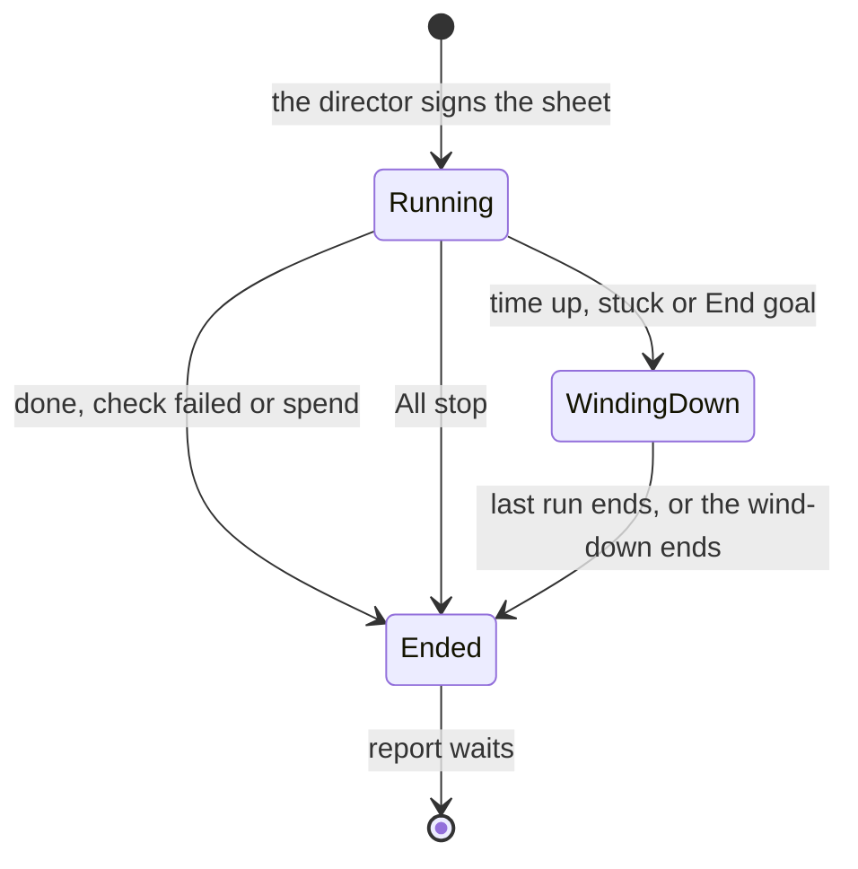

<!-- docs/specs/2026-10-31-unattended-goals-design.md -->

# Unattended goals: design

**Status:** approved by the director on 1 November 2026, who took every recommendation in section 15. Decision 1 is replaced by decisions 4 and 5 of `docs/specs/2026-11-01-delegated-decisions-design.md` (the delegated decisions design). Its build plan is `docs/superpowers/plans/2026-11-01-unattended-goals.md`. Nothing of a goal is built yet.

**What it adds.** The director hands Wheelhouse one well-defined goal with its bounds, leaves for about 8 hours, and comes back to a report. Where this design differs from `docs/specs/2026-10-17-wheelhouse-design.md` (the main design) or `docs/specs/2026-10-29-wheelhouse-on-archon-design.md` (the Archon design), this one wins. It builds on `docs/specs/2026-10-31-local-checks-and-git-alone-design.md` and changes nothing in it. Where it differs from the delegated decisions design, that one wins, as its section 14 states; the text below has been brought into line with it.

**Marks.** *Designer's call* marks a choice the designer made, which the director may override; section 16 lists them. **Decided** names the director's answer in section 15. "Today" means the code at commit `0c23e9ab` and Archon v0.13.0, read on 1 November 2026. The draft read commit `906ad58e`; section 3 says what has changed since.

## 1. Intent

Wheelhouse already builds while the director is away, but only by accident of what happens to go wrong. Routine work merges unattended, because a merge needs a signed clean review and not the director. The first question, sleeping Mac or dead process can then stop the night's work with no one told.

The director wants to leave Wheelhouse working on a well-defined goal for extended periods. So the director should be able to say what done means and how far Wheelhouse may go, leave, and trust three things on return: it stayed inside those bounds, it kept going past anything that could safely wait, and the report says exactly what happened.

## 2. Goals, non-goals and anti-goals

**Goals**

- One card hands over a goal: what done means, how it is checked, the spend, the time, the areas it may touch and when to stop.
- A question waits without stopping the goal. Other work carries on.
- A dropped connection, a usage limit, the Mac sleeping or a dead process doesn't end the night's work, and each one is reported.
- The report on return is the record itself, not an agent's account of it: what merged, what was decided for the director, what waits.

**Non-goals**

- Goals that need replanning as they go. A goal's pieces are listed before the director leaves (section 4).
- Running on a server, or with the Mac off. Work stays on the director's Mac.
- Windows, which follows as it does for everything on Archon.
- A goal across several projects. One goal runs per project.

**Anti-goals** (failures even if everything technically works)

- A question decided because nobody answered it. A timer never turns silence into a yes.
- Anything at level 4, a guardrail, a secret or money moved by a goal.
- A goal that spends past its bound, runs past its time, or starts work the director never saw on the sheet.
- A report that reads better than the record, or leaves out something decided for the director.
- A question the director must fill in like a form. The First Mate proposes every bound, and the director corrects what's wrong.

## 3. What is true today

Found by reading the code and Archon's source and documentation. The end of section 13 lists what reading can't settle. Since the draft, parked pieces, the merge queue's `park`, reservations and the first four parts of delegated decisions have reached the main line, so the third, sixth and seventh rows below are new. The rest stand as the draft found them.

| What | Today | Evidence |
|---|---|---|
| Routine work merges unattended | Yes. The permit needs a signed CLEAN review. The director's signed approval is needed only for work shown first, level 4 and guardrails | `scripts/engine/broker/rules.js`, `brokerDecision` |
| Away changes how work runs | No. `presence` changes only what wakes the front desk. Nothing in `scripts/engine` reads it, so the main design's "Away: features run to the end" isn't what happens. A feature's demo comes from its design's `midpoint` or `end` | `scripts/mod/courier.js`, `PRESENCE_LETS`; `scripts/engine/feature.js`, `DEMOS` |
| A run waiting on the director | Gives up its place on all work, keeps its files reserved and comes back through one list. New work holds once what waits and what runs reach twice `pace` | `scripts/engine/dispatcher.js`; `scripts/engine/waiting.js`; delegated decisions design, section 8 |
| A spend bound across work | None. Each run and each feature has a cap, but `capsReached` is always `false` | `scripts/engine/dispatch-run.js`, `tick` |
| A bound on where work may touch | None a script checks. `notInScope` is words in the order; only guardrails and protected tests are enforced | `scripts/engine/order.js` |
| The merge queue's question about an unclear pull request | Where the queue offers `park`, the router takes it on all work and raises the director's approval card, and later sweeps merge the rest. An approval goes back by a fresh hand-over. Where `park` isn't offered, the question still holds every merge. Check 90 is this design's U3 | `scripts/engine/runner.js`, `parks`; `docs/checks/90-leave-pull-request.md` |
| A run that ends `failed` | No retry anywhere. A failed slice brings a card, **Build it again** or **Stop here**. Outside a feature and the fix lane there is still no card: the work drops out of the queue with its Logbook word, "stopped by a problem", and only a clash with its reserved files can bring it back | `scripts/engine/dispatch-run.js`, `heldUp`, `strandedTick`; `scripts/engine/words.js` |
| A run whose process died (`owner_lost`) | A card with no options. `cancel` refuses with no owner, `resume` refuses a running run, a fresh run on its branch meets "Workflow already active on this path", and only `abandon` clears it, which deletes uncommitted work. Wheelhouse never calls `abandon` | `scripts/engine/archon/adapter.js`; Archon's `cancel.ts`, `run-actions.ts`, `run-admission.ts` |
| The Mac sleeping | Nothing holds it awake. A run's minutes come from wall-clock record times, so a run asleep for six hours reads 360 minutes on waking, passes every lane's cap, and is cancelled. A cancelled run can't resume, so every step runs again | `scripts/engine/spend.js`, `runningMinutes`; `scripts/engine/runner.js`, `caps`; check 78 |
| The helper dying | Not restarted until the next sign-in or session start: the launch agent has `RunAtLoad` and no restart. Runs already going carry on, but nothing dispatches, keeps caps or passes their `gh` calls | `scripts/lib/login-start.js` |
| A usage limit | Works when the provider reports its reset: Archon parks the run, the wake process resumes it from that step at the reset, and it parks again if the limit is still there. Parked time isn't counted. With no reported reset the run fails | Archon's `run-terminal.ts`, `usageLimitWait`; `scripts/engine/archon/asks.js` |
| Reaching the phone | Only while a First Mate session runs and the computer is awake. The courier lives in the mod | Main design, section 13 |

## 4. The shape: a goal

A goal is a signed record around ordinary work. It adds no lane and no model. *Designer's call.*

- **Pieces are fixed before the director leaves.** A goal lists its work: one feature, or an ordered list of up to 12 pieces in the existing lanes, each with done checks. A list may hold more than one feature: a waiting feature no longer holds the lane, so features in a list build one at a time, and Start no longer turns a goal away because another feature is under way (delegated decisions design, section 14.2). The dispatcher stays a script that never decides anything a model would (Archon design, section 7.3). A run can't add a piece. Anything it finds goes on the ideas list.
- **Show before build still holds.** A feature in a goal needs its pitch and design approved first, and that conversation happens before the director leaves.
- **A goal isn't ready without its checks.** If the First Mate can't name the check that proves it done, the main design's own trigger applies, and it says so and offers to work the goal out with the director (section 4.2).
- **The record is signed.** The `goal` record holds the sheet (section 5). The director's click signs its hash, as an approval of work is signed today. That one click is each listed piece's approval to start, so the dispatcher reads it in place of a click per piece. A feature's design still has its own approval. Agents can read their piece's bounds through the helper and can't write them. Each work record names its goal. The record stays private.

### 4.1 The goal's check decides what done means

A published study of an agent left alone for 100 rounds ("Evolving transition-state search with agentic large language models", npj Computational Materials, 2026, 12:298) shows why. A loose check passed 99.99% of its cases and a strict one 80.88%, on the same kind of work. An unattended run does what its check rewards, so the check is the most important line on the sheet. *Designer's call* for each rule below.

- **It is fixed before the director leaves.** The goal's checks are in the signed sheet. Any file they name joins the sheet's **Won't touch** for the goal's life, so no run can change it without a card, a fix on a red main line included. The protected-tests guard alone wouldn't do this: it refuses a test deleted or skipped, not a test edited.
- **It is outside the agents' reach.** Each check is run by the helper's route and signed, never reported by a step.
- **It is pass or fail.** Nothing scores partial credit. Three checks of four passing is not Done, and the report says which one failed.
- **At least one check must fail today.** Start runs the goal's checks on the main line and refuses a goal whose checks all pass already, since they would prove nothing. A check that must simply keep passing, such as the whole test suite, may sit beside it.
- **The last check covers everything.** Work dropped from view early can break later, so the end repeats the goal's checks and every piece's done checks against the main line's final head. A goal's own checks are tests or commands, so a script can run them with no model. A page check belongs to its piece: its preview walked it when the piece was built, the last check doesn't walk it again, and the report says so.

### 4.2 Which goals this suits

**It suits work with a cheap, plain pass or fail:** behaviour a test or a page check can prove; a list of bugs, each with a reproduction; moving code to a new shape under tests that already exist; a feature whose design is approved, built behind its switch.

**It doesn't suit work judged by taste or by people:** "make the page feel better", a new look, wording that has to persuade, anything measured by what users do, or working out what to build. The First Mate says so at the sheet, and offers a piece that does suit, such as a prototype to look at on return. A goal may mix the two only where the part needing judgement stops at a preview for the director.

### 4.3 Weighed and not used

*Designer's call* for each.

- **Away as the switch.** Away has no done, no spend and no scope, and it covers every project on the computer. A quick press shouldn't widen what agents may do (section 11).
- **A timer on questions** ("if there's no answer in an hour, take the recommendation"). That is silence as consent, which the main design rules out.
- **A model overseeing the night and replanning.** It would break the rule that no model runs between runs, cost more, and judge its own progress.

## 5. Handing over

The director says something like "Add the export page, I'm back at 6." The First Mate works as in intake, then shows one card, the goal sheet:

> **Goal: customers can export their orders**
>
> **Done means:** the export page downloads a file with every order, and the tests pass on the main line.
> **The work:** 4 slices, one feature, behind the switch `order-export`. You see it at the end.
> **May touch:** the orders area and its tests. **Won't touch:** billing and sign-in.
> **Spend:** up to a third of what's left of this week's allowance.
> **Time:** stops starting work at 6:00 PM.
> **If it has a question:** that piece waits and the rest goes on.
> **It stops early if:** two pieces fail in a row, or the main line goes red twice.
>
> **Ready to leave?** The Mac is plugged in, its lid is open, and the First Mate stays open for your phone.

Options: **Start** (recommended), **Change something…**, **Not now**. The usual card lines (why it comes to the director, what happens meanwhile) follow the card rules.

| Bound | What the director sees | What enforces it |
|---|---|---|
| Done | The goal's done checks, in the same forms as an order's, and in plain words what each proves | Sections 4.1 and 8 |
| Work | The list of pieces. A tick beside a small visible piece waives showing it first, recorded as any waiver is | The dispatcher starts only the goal's work while a goal runs. Work queued outside it waits (*Designer's call*) |
| Areas | May touch, won't touch, as path patterns | The order's words; the tool guard, which asks the helper for them as the protected-tests guard does; and the permit, which refuses a merge whose changed paths fall outside. Guardrails can't be listed: they still need the signed approval |
| Spend | A share of the week's allowance, and the tokens behind it | Two limits, and the first reached ends the goal. **Tokens** always apply, by default the sum of the pieces' caps. The meter adds the goal's `cost` records, each live run's spend and the merge-queue runs started during the goal, which have no `cost` record today. Unknown spend counts as the run's whole cap, never zero. **The allowance** is known only as a percentage, so this limit is points of the week used since Start, read from the allowance reading while it is fresh. With no fresh reading the tokens stand alone and the report says so. A Copilot project uses its counted requests in place of the allowance. A piece starts only if its lane's cap still fits the tokens. **Decided:** by default up to a third of what's left of the week's allowance, and the director can change that on the sheet (decision 4) |
| Time | A clock time, at most 24 hours ahead | `until` in the record (section 8). **Decided:** decision 3 |
| Questions | A question parks, and the rest goes on | Section 7. The delegated decisions design adds a tick per signed rule at its stage 1 |
| Early stop | Stated, with defaults | Section 8 |

**The sheet's other lines.** The delegated decisions design (section 6) adds who it's for and why now, no-gos in words, examples of right and wrong, good enough, and which kinds the First Mate may decide. They belong to its stage 1 and arrive with it. The sheet's hash covers the whole sheet, so they need no second kind of signature.

**Checks before leaving.** Start runs these, and the card shows only what's wrong. A failure in the first group refuses Start, in one plain line:

- **Must pass:** the engine's health; All stop off and no open incident; the main line green; a test command known; every piece's lane on `engineLanes`; every feature's design approved; paid usage turned off, on an account where check U4 found a limit can bill (section 9.3); at least one of the goal's checks failing today (section 4.1). That last check runs before the card is shown, once the First Mate has the sheet's checks, and takes no model.
- **Warns:** on battery, or the lid can't stay open (section 9.1); no First Mate left open, so no phone alerts and no stop from the phone; cards still waiting on the director that could hold up a piece; a midpoint demo in a feature, which parks that slice; less allowance left than the goal's spend.

**Changing a goal.** Ending or narrowing one needs nothing, as stopping must always be easy. Widening it (more time, more spend, more areas) is a new signed sheet.

## 6. While it runs

The dispatcher keeps its rules, and a goal in force adds these:

- **A piece waiting on the director gives up its slot.** This is now true of all work, built by the delegated decisions design (its section 8), with reserved paths, the way back and the parked limit. A goal adds nothing to it. A run parked at a usage limit keeps its slot, since it resumes by itself.
- **Starts stop at the bounds, wherever they start.** The check sits where every start passes (`startPiece`), not in `dispatch`, since a feature's next slice, a rework and a **Try again** all start outside `dispatch`. `capsReached` stays unused, because it would also stop the merge queue. A start held at a bound keeps its place in the list and raises no restart card. The fix lane is exempt from the time bound, since a red main line must be mended, and its spend still counts.
- **The merge queue keeps running** through a wind-down and after the goal ends, so finished work isn't stranded. Its spend counts until the goal ends, and the report names any that follows.
- **Everything left waiting on the director isn't an ending.** If nothing can run because every remaining piece waits on the director, the goal **waits**, spending nothing, until `until`. A card holding up the whole goal counts as blocking, so it reaches the phone under Away, and an answer picks the work up at once. One question on a one-feature goal therefore costs the wait, not the goal.
- **Routine pieces merge as they do today,** through the permit, one at a time.
- **Visible work stays shown first.** Only a feature has a switch. Its slices merge behind it, and the switch-on waits for the director. Any other visible piece stops at its preview, with its approval card waiting. Its pull request stays open. **Decided:** the waiver stays piece by piece on the sheet, and there is no tick for a whole goal (decision 5).
- **The merge queue's question doesn't hold the night.** Built for all work (delegated decisions, part 2e). Where the queue offers its `park` choice, the router takes it, with no ruling on the change, and raises the director's card for that pull request. Other pull requests keep merging on later sweeps. This decides nothing. The director's **Merge** click is a signed approval of that head: Wheelhouse hands the pull request to the queue afresh, since one readied at the same head only waits (check 90), and when the queue asks once more the router answers `merge` on that approval, for any lane.
- **A change outside the areas is caught before the queue.** When a piece is marked ready, the helper compares its changed paths with the areas. One outside them isn't handed to the queue. It parks with a level-3 card, **Allow this once** (signed) or **Stop**, never decided for the director. The permit's refusal stays behind it, since a refused merge alone would only be swept again. The areas govern pull requests the goal's work opened, until each merges or closes, even after the goal ends. They don't govern fix-lane pull requests, except for the goal's check files, or those opened before the goal.
- **A red main line** runs the fix lane as today, which is outside the goal's areas and counts towards its spend. A second red line stops the goal.

**The pane** gains one line in Calm's voice: "Goal: 2 of 4 added, 3 hours left, a third of its spend used."

## 7. Questions at level 3

Nothing changes at level 4. Guardrails, secrets, money, signed approvals and anything the project's rules reserve never move, and no setting moves them.

**A question parks.** The step takes its blocked exit, the run waits and spends nothing, and the card is written as any card is, under the card budget of the delegated decisions design (its section 8.5). The goal goes on with whatever doesn't depend on that piece.

**Deciding small things isn't part of this design.** The draft's six rules, its topics and its word list are gone. The director replaced them on 1 November 2026 with decisions 4 and 5 of the delegated decisions design, whose stage 1 lets the First Mate settle what a signed rule, ticked on the sheet, covers, under its guardrails. Section 14.1 of that design says what each draft rule became. A goal built to this design decides nothing, and a sheet offers no tick, until that stage is built. What it needs from a goal is in the build plan.

## 8. How a goal ends

| Ending | When | What happens |
|---|---|---|
| **Done** | Every piece merged and the last check passes; or a feature's own run passes it and only the switch-on waits | Ended |
| **Waiting for you** | The last check can't yet pass because a piece waits on the director's approval, and nothing else can run | Ended at `until`, or sooner if every remaining piece has been answered and is done. The goal's checks run again once that work merges |
| **Check failed** | Every piece merged and the last check fails | Ended, and the report names the check. This is never Done |
| **Time** | `until` passes | Winds down |
| **Spend** | The meter reaches the goal's spend | Running runs are cancelled, keeping their worktrees |
| **Stuck** | Two pieces in a row failed after their retries; or a second red main line; or no step finished for 60 minutes while a run was meant to be working (time parked at a limit, waiting on the director or asleep doesn't count) | Winds down |
| **End goal** | The director says so, from any front end | Winds down, unless they say stop now |
| **All stop** | As today | Ended at once. Lift All stop doesn't restart it: Carry on offers a new sheet |

**Winding down.** Nothing new starts. A run under way may finish, for up to 60 minutes. A run left after that, and any run parked at a usage limit, is cancelled, keeping its worktree, so nothing wakes and spends after the goal has ended. **Decided:** decision 3.

**After the end.** Runs waiting at a question or an approval stay as they are, spending nothing, and their cards still work. Answering one means the director is back, so that run carries on as ordinary work under its own lane's caps, with the areas still governing its pull request. It comes back through the same list as any answered piece, so it still asks for a place (delegated decisions design, section 8.3). Nothing else of an ended goal starts, a feature's next slice included, until the director says **Carry on**, which starts a new sheet for what's left.

**The goal's check isn't a claim.** For a feature, its own run's whole-feature review and done checks stand, which run before the switch-on wait, every slice's checks among them. The sheet's own checks are a separate list, added to that run's order. For a list of pieces, once nothing can run, a last run with no model step makes the goal's checks and every merged piece's test and command checks against the main line's head, in a folder of its own, so nothing it does reaches the project. The helper signs the result from Archon's record, as it signs reviews. A failure there means the goal isn't Done, whatever merged, and the endings above say which it is. Where checks run on this computer, the local-checks design's signed check is the same evidence. *Designer's call.*

## 9. Recovery

**The rule.** Wheelhouse restarts what it knows is safe to restart, a limited number of times, says so in the report, and otherwise parks. Everything in 9.1 to 9.4 applies whether or not a goal is running, since each is a hole in everyday work too. *Designer's call.*

| Event | What must restart it, today | With this design |
|---|---|---|
| The helper's stream or the wake process stops | The helper restarts both; a saved cursor and the open-ask snapshot lose nothing (check 78, 50 trials) | The same |
| A connection drops mid-step | Archon's retries (2 by default, 3 seconds apart and growing), then the run fails, and nothing restarts it | 9.2 |
| A usage limit, reset reported | The wake process, at the reset | The same, and the goal knows (9.3) |
| A usage limit, no reset reported | Nothing: the run fails | 9.2 |
| The Mac sleeps | Waking; then the minutes cap cancels the run | 9.1 |
| The helper dies | The next sign-in or session start | 9.4 |
| The Mac restarts | Sign-in, then the helper. Each running run comes back as `owner_lost` | 9.4 and 9.5 |
| A run's process dies | Nothing can | 9.5 |

### 9.1 Staying awake, and sleep that happens anyway

- **Wheelhouse holds the Mac awake during a goal,** with `caffeinate` tied to the helper's process. It needs no password and changes no setting, and it ends with the goal. **Decided:** decision 2.
- **Its limits are said at Start.** It holds only on mains power, and a closed lid still sleeps the Mac unless a display is attached. Check U1 confirms both on this Mac.
- **Sleep doesn't count as running.** The helper's tick already fires each minute, so a gap of more than three minutes means the computer slept. It writes a `slept` record with the times, and `runningMinutes` leaves those spans out. So a sleep can no longer cancel a run through its cap. A gap is measured inside the running helper, so a helper that was dead leaves no `slept` record, which is right: its runs went on.
- **`until` stays a clock time.** A goal doesn't get longer because the Mac slept. The report gives the hours lost.

### 9.2 A run that failed

The helper reads the failure's kind from the stream's `terminal` line, which the adapter now drops.

- **Connection, provider or host trouble, or a limit with no reset:** resume the run, skipping finished steps, at 5, 15 and 30 minutes. Archon says a failed run resumes, but check 78 tried only a cancelled one, so U4 tries it.
- **A resumed run must count again.** Today its `ended` record is final: caps, pace and the meter would all lose sight of it, the continuation host would drop its second ending as a repeat, and it could have only one `cost` record. So a resume writes a `started` record of its own, numbered by the resume, its ending is written under that number, and the spend and the reviews are settled only when the run truly ends. **Give it more**'s resume of a failed run goes the same way.
- **Anything else, or the third retry failing:** the piece parks with a card: **Try again**, **Stop here**, **Suggest a change…**, as the card for a piece that couldn't start again does. Today outside a feature there is no card at all. A slice keeps the card it has, **Build it again** or **Stop here**, which now comes after the retries. A fix-lane run keeps its own card, after the retries too.
- **What isn't retried.** A merge-queue run, since the next sweep is its retry, and a reader, whose failure costs a reading and nothing else. Neither has a `run` record.
- **A retry holds its files and asks for a place.** Between tries the piece keeps its reservation. A retry comes back through the same list as an answered piece, so it never passes `pace`. The fix lane is the exception, as everywhere: it runs under the incident that holds that list, so its retries and carry-ons go by its own decision.
- **A retry is a start for a goal's bounds.** One that would fall past `until`, in a wind-down or after a spend ending doesn't run, and the piece parks with its card.
- **A failed piece doesn't end the goal.** It counts as a failed try and the goal goes on with what doesn't depend on it, up to the stop in section 8.
- **A later try knows what failed.** A fresh run for the same piece, after a card's **Try again** or a carry-on, gets a short `tried` list in its order: each earlier run's failed step, the kind of failure and which checks failed. The helper writes it from Archon's record, never from a step's own account, so a run doesn't repeat what already failed. *Designer's call.*

### 9.3 Usage limits

- **While any run is parked at a limit, nothing new starts.** Today the dispatcher would start more work, which hits the same limit. Work on its way back waits too, and the fix lane and the merge queue don't: a red main line must be mended, and a queue run has its own limit to meet.
- **The goal's clock keeps running.** If the reset falls after `until`, the goal ends at `until` and the parked run is cancelled (section 8), so a weekly limit can't leave work resuming days later.
- **The spend bound usually comes first.** It stops the goal before the allowance runs out, so a limit is mostly a five-hour window passing, not the week ending.
- **Money.** If the account can spill into paid usage, a limit may bill rather than pause, and Wheelhouse can't see that from here. Check U4 finds out. Until then the sheet says so once, where that may apply.

### 9.4 A helper that stays up

The launch agent also runs the start command every 60 seconds (`StartInterval`). It already leaves a running helper alone. So a helper that dies is back within a minute, with no admin and no change the director sees. It is listed on setup's card of changes to this computer, as the agent is now, and uninstall removes it with the agent. A computer set up before this has the old entry, and launchd reads an entry only when it loads it. So the helper, finding the old entry when it starts, writes the new one and loads it again once, with no admin, and says so on the Logbook. The one stop on purpose today is the last uninstall, so removing the agent also unloads it: launchd would otherwise go on starting a helper from an entry it still holds.

### 9.5 A run that lost its process

Wheelhouse already carries one patch to Archon that lets `cancel` take a paused run, keeping its worktree. **It extends that patch** so `cancel` also takes a running run whose owner is unreachable, keeping its worktree. It records nothing it can't prove: the owner is confirmed gone first. *Designer's call*, chosen over `abandon`, which deletes uncommitted work, and over waiting a day for `--resume`.

Then the helper starts a fresh run on the same branch with "carry on from what's there" and the spend carried, once. Every step runs again, as check 78 found, and each lane's steps already allow for that. A second loss parks the piece. The card raised on `owner_lost` today gains real options, for a second loss: **Carry on**, **Stop**. Its answer goes to the helper, never to Archon, which has no ask to answer. All of this applies outside a goal too (section 16, call 12). Check U2 tries it all first.

## 10. The report

The director reads it on return, first, as the briefing's opening. It comes from `read('goal')` on the desk, so every front end gets the same one.

**It is made by a script from the record, in Calm's voice, with no model.** So it can't flatter, and it costs nothing. It stays in the private record, never in a pull request or the repository. The First Mate may read it out, and adds nothing to it but answers to the director's questions.

> **The export page is ready for your switch-on.** Done at 4:40 PM, inside its time and spend.
>
> **Added (4):** Export button · File format · Large orders · Download page. All behind `order-export`, all checks passing. [Pictures]
>
> **Waits for you (1):**
> - Switch it on, once you've looked. [Show me]
>
> **What went wrong:** The Mac slept for 40 minutes at 1:10 PM. A usage limit held work for 55 minutes. One step was retried after a dropped connection. Nothing was lost.
>
> **Spent:** 28 points of this week's allowance, of the 33 you allowed, read at 4:38 PM.

The rules:

- **A fixed order,** in the order the director needs: the verdict, then Added, Decided for you, Waits for you, What went wrong, Spent. An empty part is left out, except **Decided for you**, which says "Nothing" when a goal allowed it. That part and its **Keep** and **Change…** come with the delegated decisions design's stage 1, which splits it into flagged and told; a goal built to this design shows no such part.
- **The verdict says what's true:** Done, or stopped and why, with what's left undone listed by name.
- **Nothing is rounded up.** A piece merged is **Added**. A piece built and waiting is under **Waits**. Unknown spend reads as unknown.
- **A sitting isn't a day.** The waiting list shows the top four in the usual order of importance, and the rest are listed by name and one click away, as the delegated decisions design says (section 8.5). All of Decided for you counts as one card.
- **It stays on the Logbook,** and the briefing links to it until each item in it is settled.

## 11. Away and goals

**A goal carries its own bounds, and Away drives none of them.** *Designer's call.*

- **Away says who to tell. A goal says what may happen.** Authority comes from a signed sheet naming the work, and a press of a setting can't widen it.
- **They differ in scope.** Away is the director's, across every project on this computer, while a goal belongs to one project. The director can be away with no goal, and a goal can run while they're here.
- **Starting a goal sets Away until `until`,** as a convenience, unless Do not disturb or a nearer Away is set. Coming back early changes nothing about the goal. It runs on, and cards show as they do for someone here.
- **A goal's ending** joins the courier's needs-you items. A goal that stopped early lets through Away, as a blocking card does. A goal that finished wakes only while the director is here, as a finished feature does, and waits in the briefing.
- **The main design's settings table** should read: "Away: only breakages and questions that block all work notify." The words "features run to the end" go, since neither Away nor anything else makes that true. Midpoint or end is the feature's own, and on a goal the sheet shows it.

## 12. What changes, part by part

For the build plan to work from. Nothing here is a plan.

| Part | Change |
|---|---|
| Records | New kind `goal`, signed by a `start-goal` action over its hash, as `work` is by `approve-work`; new helper-only kinds `slept`, `goal-end`, `goal-check`. `work` names its goal as `goalId`, since its order's `goal` is already the work's own words. `run` gains `resume` and `failure` |
| Desk | `read('goal')`, `act('start-goal')` with evidence, `act('end-goal')` without, a `goal-changed` watch event |
| First Mate | The goal sheet in intake, written as a card; the checks before leaving |
| Work order | The goal's areas, with its check files in Won't touch, and the `tried` list |
| Pack | A last read-only goal-check workflow, with no model step |
| Dispatcher | A goal's work only; the sheet as each piece's approval; the bound check in `startPiece`; no starts during a limit; the endings of section 8 |
| Runner | Failed runs and lost runs, and a resumed run counting again (sections 9.2, 9.5); `tried` lists; the spend meter across a goal, with merge-queue runs; holding an ended goal's work |
| Spend | `runningMinutes` leaves out `slept` spans |
| Permit and mark ready | Paths outside the goal's areas park at mark ready, and the permit refuses them behind that. This also reaches the local queue |
| Adapter | Keeps the failure's kind from `terminal`; options on `owner_lost`; the extended patch |
| Helper | Holds the Mac awake; the sleep gap; the start interval on the launch agent |
| Courier and pane | The goal's ending as a needs-you item; the pane's goal line |
| Report | A new view from the record |

**Works without a host.** Everything here sits on the dispatcher, the permit and the record, which a project in git alone shares. The merge-queue question doesn't hold anything there: the local queue raises its card and moves to the next change.

**Evaluation.** The new scenarios (below) join the one counted evaluation, once for the plan, as the token rules say. The fake engine plays back recorded failures, limits and lost owners.

Scenarios: a goal to Done; each ending; a goal refused because its checks already pass; a run trying to change a goal's check file; a late piece breaking an earlier one, caught by the last check; a retry that sees its `tried` list; a question parked while other work merges; a change outside the areas refused; a spend bound reached mid-run; a sleep across a run; a failed run retried; a lost run carried on; a run parked past `until`; a report checked line by line against its record.

## 13. Early checks

Short trials on the Mac, each with an answer note in `docs/checks/`, as the Archon design's were. Agents run what they can. Only the lid and spend go to the director, through the main session. U3 is done: check 90 answered yes, with a fresh hand-over as the way back, and part 2e of delegated decisions built on it.

| Check | What it answers | If it fails |
|---|---|---|
| **U1, sleep** (the sleep half of check 78, never run) | With a run going: does `caffeinate` hold the Mac awake on mains, and with the lid shut? After a real sleep of 1 and 30 minutes, do the run's owner, its step and the stream carry on? Does the sleep gap show? | A step that dies on waking goes by 9.2. If `caffeinate` doesn't hold, the sheet asks the director to set this themselves |
| **U2, a lost owner** | With a step running, kill its owner. Does the patched `cancel` take it and keep the worktree, and does a fresh run start on the branch? | The piece parks with its card, and nothing is carried on by itself |
| **U4, a limit and a dropped connection** | What the real failure kinds are when the connection is cut mid-step and when a limit is reached; whether a failed run resumes, skipping finished steps, under the same id and its ticket; and whether paid usage can start in place of a pause | The retry table in 9.2 follows what's found. If paid usage can start, the sheet refuses a goal on such an account until the director has turned it off |
| **U5, one real goal** | A goal of about 8 hours on a throwaway project, end to end, once everything is built | It is the last check before real use. It needs the director's yes for its spend |

**Not tried, and only a run can show:** how a step's idle timeout behaves across a sleep, whether a step survives one, and the real failure kinds. U1 and U4 answer these. Nothing above assumes a result without a fallback.

## 14. Risks

| Risk | How this design handles it |
|---|---|
| A weak check lets poor work count as Done | The sheet says in plain words what each check proves, one must fail today, and the First Mate turns away goals with no real check (section 4). A strong check is still the First Mate's and the director's judgement, not a script's |
| The number of parked pieces makes a goal achieve little | The report shows it. Better sheets are the answer, not looser rules |
| A goal's worth of pull requests merges on the review alone | As routine work does today. The goal's areas and check add to that. Visible work still waits |
| A patch to Archon grows | One small addition to the one patch, offered upstream with it, and re-checked at each monthly upgrade |
| Retrying hides a real fault | Three tries at most, each in the report. Two failed pieces in a row end the goal |
| The phone stays silent with no session open | A warning at Start. The report waits in any case, as the main design says of the phone |
| Allowance shared with another project's goal | The check before leaving shows what else is running. Each goal's bound stands, and usage limits behave as in 9.3 |

## 15. Decisions for the director

Decided by the director on 1 November 2026, who took every recommendation.

1. **May a goal decide small things for you?** Replaced by decisions 4 and 5 of the delegated decisions design: eight candidate rules noted and signed one at a time, and the evidence bar set after record-only has run. A goal built to this design decides nothing.
2. **May Wheelhouse keep your Mac awake during a goal?** **Yes.** It needs mains power and the lid open, and ends with the goal.
3. **What happens when time is up?** **(a)** Nothing new starts, and work under way has up to 60 minutes to finish.
4. **How much may a goal spend unless you say otherwise?** **Up to a third of what's left of the week's allowance,** and the director can change that on the sheet.
5. **Can you waive "show me first" for a whole goal?** **(a)** No. It stays piece by piece on the sheet.
6. **When is this built?** **(a)** Recovery (section 9) first, straight away, then the rest.

## 16. The designer's calls

These stand. Calls 8 and 9 are replaced by the delegated decisions design's calls, and calls 6, 7 and 19 changed with it, as marked.

1. A goal wraps ordinary work: no lane, no model, and pieces fixed up front (section 4).
2. No timer on questions, and no model overseeing the night (section 4).
3. At most 12 pieces, at most 24 hours, one goal per project (sections 4 and 5).
4. While a goal runs, the dispatcher starts only its work (section 5).
5. Areas are enforced at the permit, with the tool guard ahead of it (section 5).
6. Parked runs give up their slots, and runs parked at a limit don't (section 6). The first half now holds for all work.
7. The queue's `park` answer, now for all work, and `merge` on a signed approval for any lane (section 6).
8. *Replaced.* Delegated decisions design, sections 9 to 11.
9. *Replaced.* Delegated decisions design, section 10.
10. The early-stop defaults, and 60 minutes of wind-down (section 8).
11. A signed check on the main line proves a goal done (section 8).
12. Recovery applies to all work, goal or not (section 9).
13. Three retries at 5, 15 and 30 minutes, and one carry-on after a lost owner (sections 9.2 and 9.5).
14. Extending the Archon patch rather than calling `abandon` (section 9.5).
15. The report is a script's, with no model (section 10).
16. A goal carries its bounds, and starting one sets Away as a convenience (section 11).
17. The rules for a goal's check, and which goals suit (sections 4.1 and 4.2).
18. A `tried` list in the order of a later run (section 9.2).
19. The sheet is each piece's approval to start (section 4). A list may now hold several features, built one at a time.
20. When all that's left waits on the director, the goal waits until `until` (section 6).
21. Only a feature has a switch; any other visible piece waits at its preview (section 6).
22. The merge queue runs on through a wind-down and after the goal (section 6).
23. A change outside the areas parks at mark ready (section 6).
24. After a goal ends, parked runs stay and an answered one is ordinary work; nothing else starts until Carry on (section 8).
25. Tokens and allowance points as two limits, the first reached ending the goal (section 5).

## 17. Left to the builder

- The exact fields of the new records, and how the sheet's hash is signed, within the existing signing.
- The sheet's and report's wording, in Calm's voice.
- How path patterns are written and matched, and how the First Mate proposes them.
- How a gap in the tick is measured, within section 9.1's rule.
- The goal-check workflow's steps, within section 8.

## 18. After approval

The build plan is `docs/superpowers/plans/2026-11-01-unattended-goals.md`, one session a part, with recovery first and checks U1, U2 and U4 ahead of the parts that rest on them, and U5 last.
