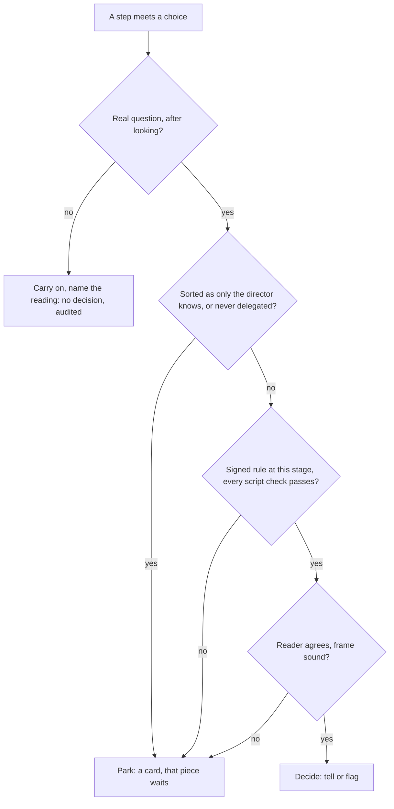

<!-- docs/specs/2026-11-01-delegated-decisions-design.md -->

# Delegated decisions: design

**Status:** draft for the director's approval, 1 November 2026. Nothing in it is built. Section 17 holds the six decisions left to the director, each with a recommendation.

**What it adds.** The director hands Wheelhouse intent and limits instead of a plan. The First Mate settles the small decisions a signed rule covers, under guardrails that rest on what a script can see, so that well-defined work can run for long stretches, such as 8 hours, without the director. Where this design differs from `docs/specs/2026-10-17-wheelhouse-design.md` (the main design), `docs/specs/2026-10-29-wheelhouse-on-archon-design.md` (the Archon design) or the unattended goals draft (`docs/specs/2026-10-31-unattended-goals-design.md`, not yet on main; the goals draft below), this one wins once approved. Section 14 states every such difference. The goals draft isn't approved, so stages 1 and above depend on it; record-only mode doesn't.

**Marks.** *Designer's call* marks a choice the designer made, which the director may override; section 18 lists them. **Open** marks one of the six decisions in section 17. *Inference* marks a conclusion carried over from elsewhere, untested here. "First cut" marks a figure from one owner's question history, read on one computer and so far incomplete (section 3). "Today" means the code at commit `906ad58e`, read on 1 November 2026.

## 1. Intent

Most questions that reach the director fall into two groups: ones they can't improve on, and ones only they can answer. Every question today waits the same way, and a waiting question can stop unrelated work. So long stretches of work end at the first few questions, and the director's attention goes to cards that a rule could have answered.

The director doesn't want the way out to be planning everything ahead, because real work can't be fully planned. Strong teams hand over purpose and bounds and leave the answers local. The same shape fits here, with one hard difference: an agent's sense that something is minor can't be trusted, so every stop and every clearance must rest on a fact a script can check.

## 2. Goals, non-goals and anti-goals

**Goals**

- The director hands over intent: a standing brief per project and a sheet per goal.
- A question is sorted by who holds the answer, not by how big it feels.
- Wheelhouse proposes moving a kind of question to the First Mate only on evidence, only the director's signature moves it, and it falls back at once on a reversal.
- A parked piece stops only what depends on it.
- The record shows what was decided, on whose authority, what proved it and what happened next.

**Non-goals**

- Removing most questions. About 35% or more stay with the director at every stage (first cut). This design promises no less than that floor.
- Learning a profile of the director from their clicks. Patterns may draft a rule. Only a signature makes one.
- Any decision about budget allocation, which stays in the backlog.

**What doesn't move**

- The first build is record-only mode and changes no outcome. Its work runs beside the cards: no card waits for it, and none of its spend counts against a piece. If the director turns blind cards on (decision 1), they are the one stated exception, since seeing a recommendation later may change an answer.
- Level 4 (safety rules, secrets, money) never moves, at any stage, by any setting.
- Silence never settles anything. A timer never turns into a yes.
- An agent's confidence, or its own word, clears nothing.
- Wheelhouse fits around any project as it is. Every check below reads what the project already has. A check that can't run in a project parks the decision. It never asks the project to change shape.

**Anti-goals** (failures even if everything technically works)

- A question settled from an option list when the right answer was that the options were wrong.
- A report that reads better than the record, or a click that means less than it looks.
- A rule wider than the director meant, written in words an agent chose.
- A clean run of agreement read as proof.

## 3. What the first cut says

The source is one owner's real question history, with test and evaluation runs removed. Half of it comes from one project, and two long sessions hold a third. **Every figure here is first cut.** More history may follow. No rule, stage or gate in this design reads any of these figures: they are reasons, and a new reading changes the reasons, not the structure. No promotion threshold comes from them (section 13.3).

| Finding | First cut |
|---|---|
| Took the recommendation unchanged, of readable answers with one | 66%, plus 5% with an added requirement |
| Chose another offered option | 12% |
| Typed something different | 8% |
| Challenged the premise in chat | 5% |
| Asked back | 4% |
| All questions answered outside the offered options | 28% |
| Unchanged takes faster than a full read | 18% |
| Reversals visible soon after an unchanged take | 3% (range about 1% to 11%, and probably low) |
| Departures resting on a preference / a fact only the director held / correcting the agent | 69% / 22% / 8% |
| Questions asked again though already open | about 6% |
| Questions the first eight rules might remove | 17% to 24%, upper end optimistic |
| Plain-chat questions, not sorted | about two-thirds of the card count; a rough count of end punctuation |

| Who holds the answer | Share of questions | Took unchanged |
|---|---:|---:|
| Only the director knows | 42% | 51% |
| Project could have answered | 15% | 95% |
| Never delegated | 14% | 53% |
| Director can see | 14% | 64% |
| Director can't judge | 14% | 81% |
| Not a real question | 2% | a handful of cases |

**The limits that shape this design.**

- The take rates show where the director departs, not where the agent was right. Agreement is inflated by anchoring, and no figure here gives the blind number.
- A second, blind reader agreed with the sort 70% of the time (moderate), and kept more with the director. On that sample the delegable kinds fell from 19% to 6%. So 30% over the whole history is a ceiling.
- Recommendations that lean the wrong way consistently stay hidden behind take rates: one early recommendation kept pointing one way while the director chose the other.
- Any row of fewer than about 30 cases is a pointer. Most per-topic counts are smaller than that.
- The director reads technical detail better than the non-developer the product is for, so "can't judge" may be larger for others.

**What outside research adds.** Several fields agree that accepting a recommendation isn't evidence that it was right, that a model's stated confidence can't gate a decision, and that people catch little in routine review. No study tests a non-developer directing agents who settle decisions for them, so everything carried over from research is *Inference*. Section 20 lists the sources.

## 4. What is true today

| What | Today | Evidence |
|---|---|---|
| A level-3 ask lowered to level 2 | Answered by the step's own recommendation. No check beyond the ask's `topic` label, which the step gives | `scripts/engine/router.js`, `routeAsk`, `lowered` |
| What proposes a lower level | Five "approved unchanged" answers since the last review | Main design, section 6; `scripts/frontdesk/learning.js` |
| A paused run | Holds its pace slot. Three waits fill `pace`, and nothing new starts | `scripts/engine/dispatcher.js`, `live`; pinned by `tests/scripts/engine/dispatcher.test.js` |
| A feature | Holds a slot and the one feature place from its first slice to its end, even while waiting on the director for days | Same, `live`; `PACE.featureLane` |
| What `paused` means | Any ask, including a usage limit, which resumes by itself. The record alone doesn't say the director is needed | `scripts/engine/host.js`; `scripts/engine/archon/asks.js` |
| Runs that restart without the dispatcher | A rework, a cap's Give it more and a feature's next slice all call `startPiece` directly, past pace | `scripts/engine/runner.js`, `reworks`, `capAnswer`; `scripts/engine/dispatch-run.js`, `featureTick` |
| The card budget | `cardsPerDay` defaults to 3, by calendar day, and gates writing the card at all. A fourth question isn't a card until the next day, even with the director at the desk | `scripts/engine/runner.js`, `showNow`; `scripts/engine/router.js`, `cardBudget` |
| A repeated question | Only a `blocked` ask with exactly the same text is answered from an earlier answer | `scripts/engine/runner.js`, `onAsk` |
| A switch's off check | Says only that the flags file doesn't read on. A switch given in words returns clean without being looked at | `scripts/engine/flag.js`, `--check-off` |
| Presence | Decides only what wakes the front desk. Nothing in `scripts/engine` reads it | `scripts/mod/courier.js`, `PRESENCE_LETS` |
| What permits a merge | All stop off, the lock, no incident, a signed CLEAN review of that head, and the director's signed approval where shown first, level 4 or a guardrail. An approval must be the director's signed record | `scripts/engine/broker/rules.js`, `brokerDecision`; `scripts/gate/conditions.js`, `approvalCounts` |
| Questions in plain chat | Not recorded as questions. A typed "yes" approves nothing, but nothing counts or sorts what was asked | Main design, sections 5.3 and 5.4 |

## 5. The shape

**"The First Mate decides" means a script and a separate reader, not an open session.** The director's words stay as they are, but no front-desk session has to be running, and no model watches the night. The card router (a script) applies the checks. A small read-only run, the **reader**, gives an independent opinion. The step's recommendation is one input. A decision exists only when the script says every check passed. *Designer's call.*

Anything missing, unreadable or in doubt goes to the park box. No path in this chart reads the director's presence, a clock or a level of confidence. Presence says who to tell, and a press of a setting can't widen what agents may do.

## 6. What the director hands over

Intent, not a plan. Two short records, both drawn out by the First Mate in conversation and never filled in as forms.

**The standing brief, one per project.** A signed record in the private record, which agents read through the helper and can't write.

- Who the product is for, and what they should be able to do.
- What it's for now, and what matters most.
- No-gos and what must stay as it is.
- Two or three examples of right and wrong, since taste is easier to show than to state.
- Facts the project can't show, each with its date: which account, what a machine can reach. Nothing secret goes here.

The First Mate proposes it from what the project already holds, and the director corrects it. A blank line is allowed and means only that more questions park. A project with no brief works as it does today.

**The goal sheet, one per goal.** The goals draft's sheet (its section 5) gains five lines, so it now holds:

| Line | Example | What enforces it |
|---|---|---|
| Who it's for, and why now | "Shop owners, so they stop asking support for order files" | The reader's reference for the test in section 7.1 |
| Done means, and how it's checked | As the goals draft | Goals draft, sections 4.1 and 8 |
| Time and money limits | As the goals draft | Goals draft, section 5 |
| Areas and no-gos | "Won't touch billing or sign-in" | The tool guard and the permit, as paths; the no-gos in words go to the reader, and can only park |
| Examples of right and wrong | "Like the invoices page. Not a wizard" | The reader's reference; the director's words stay verbatim |
| Good enough | "Better than the spreadsheet they use now" | The reader's reference |
| Which kinds the First Mate may decide | A tick per signed rule | Section 9 |

**The pieces belong to the First Mate.** The list of pieces on the sheet is the First Mate's proposal, shown to the director. At stages 0 to 2 it stays as the goals draft has it: fixed when the goal starts, since the dispatcher stays a script and a run can't add a piece. At stage 3 the First Mate may change the list within the sheet's limits (section 13). **Open**, decision 6.

**Intent has limits as authority.** The goal's purpose doesn't authorise each step towards it. A sheet's words can settle a question only through a signed rule (section 9, guardrail 2).

## 7. Sorting a question

### 7.1 The test for a real question

A question is real only if **all three** hold: there are several defensible readings; they lead to outcomes someone could observe to differ; and nothing in the brief, the sheet, the order or a signed rule selects between them. *Designer's call*, adapted from BMAD's test for ambiguity.

Where it fails, the step takes the one reading, names it in its report, and goes on. The step must look in the project first, and a line of the project on main at the piece's base may be what selects the reading.

**This is no clearance.** Steps already settle such matters silently today. This test gives that a written form and adds no authority. It makes no `decision`, can't answer an ask, and a question already raised can't be withdrawn as "not real". A step can't be trusted to apply it to itself, so a wrong "not real" is a missed question. Two things stand behind that. The audit in section 12 samples the named lines. And from stage 1, when a piece is marked ready, the script runs the exclusions it can test against the whole change (section 9, guardrail 1). One that hits with no card or rule behind it parks at that point.

### 7.2 The six kinds

| Kind | Example | What happens |
|---|---|---|
| **Not a real question** | Two equivalent ways of writing the same thing | The step carries on, naming its reading |
| **Project can answer** | "What do we call this elsewhere?" | Before asking: the step looks it up, as in section 7.1. Once raised as an ask, it takes the full path, and the "written rule" class is how a signed text answers it (section 11.2). Project text the step can write is evidence only, and counts only if it's on main at the piece's base |
| **Director can't judge** | Which of two technical approaches | Decided under a signed rule, proved by tests. Otherwise parks |
| **Director can see** | Which of two layouts | Decided and flagged under a signed rule, behind a switch or held from merging. Otherwise parks |
| **Only the director knows** | Who this is for, which account, what matters more | Parks, however small it looks |
| **Never delegated** | Level 4; access; where records live; a change of scope or to what was decided; a new kind of claim to users | Parks. No rule can cover it |

Sorting is itself unreliable: two readers of one history agreed about 70% of the time (first cut). So the sort is never a clearance.

- The step proposes a kind. The reader sorts it again without seeing that (section 9, guardrail 4).
- **The stricter sort wins.** The order, nearest the director first, is: never delegated, only the director knows, can see, can't judge, project can answer. Where the two differ, the one nearer the director applies.
- The sort can raise a question towards the director. On its own it can't send one away: that takes a signed rule and every script check.
- A step must look before it asks. From stage 1, an ask that doesn't say what it searched is sent back once.

### 7.3 Rejecting the frame

In the first cut 28% of questions were answered outside the offered options, and the costliest disagreements were chat challenges to the premise. A First Mate that picks from a list closes all of those off. So settling needs more than a pick, and the director keeps a way to reject the question itself.

- **The reader is asked about the frame first, in its own output, before it picks.** Are these the right options? What does the question assume? Is an option missing? "Doubtful" parks it. *Designer's call.*
- **The kinds that drew those challenges can't be settled.** Access, where records live and whether the option set is right are never delegated.
- **Every settled decision offers Wrong question…** beside **Change…**, on the report and on the Logbook, for as long as the record exists. It takes the director's words, as new work where needed, and records a `frame` reversal, which falls harder than a change (section 13.2).
- **A parked card never narrows to its options.** Free text stays on every card, and **Suggest a change…** stays.
- **Evidence counts leaving the list as a miss.** In record-only mode a typed answer, a chat challenge or an added requirement never counts as a match, so a kind the director often steps out of can't look safe (section 12).
- **A principle given in answer** ("take the proper long-term option") becomes a draft rule in the director's own words (section 11).

### 7.4 Asking each decision once

This needs no delegation, and removes about 6% of questions (first cut).

- **One decision, one card.** The helper gives each ask a decision key from its piece and its normalised words, by script. The step's topic label plays no part. An ask with an open key joins that card and raises no other. An ask with an answered key takes the director's earlier answer, as a blocked exit does today, and never at level 4.
- **Close matches never answer.** A model's reading may only help the director. Where the reader says an ask is the same decision as an open card, that card gains the second wording, so the director sees both and their one click knowingly answers both. Where it matches an answered card, a new card says "You said this before" with that answer first, for one click. Where it can't say, an ordinary card is raised.
- **An answer given in chat.** Where the director has already said what they want in chat, the card carries their words and asks for one click. Typed words still steer and never approve.
- **Stale answers die.** An earlier answer isn't reused once the director has spoken on that piece since, or has changed that answer.

### 7.5 Questions in plain chat

Plain-chat questions run at about two-thirds of the card count (first cut, a rough count) and weren't sorted. They get no route around a guardrail, for four reasons.

1. **A run has no chat.** A step's only way to reach the director is an ask. Each step's prompt says to take the blocked exit, and an early check confirms that no step can reach the question tool (section 16, D2).
2. **A chat reply gives no authority for anything that needs a signature.** That rule stands: a typed "yes" approves nothing, and the permit reads only signed records.
3. **A chat reply can't be cited as authority.** Guardrail 2 reads only signed records. The most a chat message can do is give the words of a draft rule, which the director then signs. So an agent's own question can't turn "yes" or "go ahead" into authority.
4. **Chat questions are counted, then sampled.** The Stop hook records a `chat-question` line when the First Mate ends on a question with no card (counts only, never the words). The audit in section 12 sorts a sample by the same six kinds. Where the hook isn't available, the audit reads the transcript instead. This raises nothing to the director and can't clear anything.

The First Mate may still talk things through with the director. A decision reached in talk becomes a card, or a rule the director signs.

## 8. One parked piece doesn't stop other work

The main design says "while a preview waits, other work carries on" (section 7.3). Today's dispatcher doesn't do that. This section makes it true for all work, goal or not. **Open**, decision 2. Nothing here settles a question.

### 8.1 Waiting on the director

The test is what the runner knows, not the run's `paused` record, since a usage limit writes that too. A piece **waits on the director** when any of these holds:

- a run of it has an open ask routed to a card and not yet answered (`state.waiting`, or undelivered in `state.questions` or `state.approvals`);
- a run of it is held at its cap (`state.capped`);
- it is a feature whose next step can't go on until a card is answered, whichever card that is: its cap card, its stall card, a clash card, a merge card, an approval of its slice, a midpoint demo or its switch-on.

A run at a usage limit isn't waiting on the director. It keeps its place and resumes by itself. A feature whose slice is simply waiting to merge isn't waiting on the director either, and keeps its place.

**The merge queue is one more piece that can wait.** A paused merge-queue run still counts as running, so its question about one unclear pull request holds every merge. The goals draft's answer (take the queue's `park` choice and raise the director's card, section 6 there, check U3) applies here to all work. Where `park` isn't offered or U3 fails, the question stays as a blocking card, as it does today, and this is the one case where a single question can still hold work back.

### 8.2 What a waiting piece gives up, and what it keeps

| | Gives up | Keeps |
|---|---|---|
| Any piece | Its place in `pace` | Its worktree, branch, spend so far, and its order in the record |
| A feature | The feature place too | The rule that its slices run in order |
| Files | Nothing | **Its files stay reserved** |
| Dependants | Nothing | Work that `dependsOn` it still waits |

**Reserved files** are the piece's expected files plus every path its branch has changed so far, read by the helper when the piece parks. They stay in the clash check's `running` list from then until the piece's work merges or ends, including any gap between an answer ending a run and its fresh run starting, when nothing else would show the piece as live. A hot file reserved this way holds what would touch it, as it would for a running piece. Nothing ever releases a reservation by itself, since that would trade waiting for rework. The helper shows how many pieces a reservation holds up, and the card's rank says so. Reservations hold back new work only: two returning pieces never hold each other, the older answer goes first, and a real clash goes to the merge gate as today.

**In the dispatcher.** `live` splits in two. What runs counts for `building` and `features`. What waits on the director counts only in `running`, for the clash check. The test `running and paused runs hold their slots` changes to say that a run waiting on the director gives its slot up and keeps its files, and that a run at a usage limit keeps both. The test that a feature between slices keeps its place stays, since that feature waits on a merge, not on the director.

**A feature's slices still run in order.** A parked slice stops the later slices of its own feature, because they build on it. That is dependence, not a stall, and a one-feature goal can still wait on one question (goals draft, section 6). What ends is one feature's wait stopping every other feature.

**At most one feature builds at a time.** A second feature may start while the first waits on the director. The feature place limits what is building, not what has begun. *Designer's call.*

### 8.3 When answers bring runs back over pace

Parked pieces could return together, and no piece today passes through the dispatcher on its way back. So the answer and its delivery part.

1. **The click counts at once.** The answer is signed and recorded straight away. The card closes, and the piece enters a kept `returning` list.
2. **Delivery waits for a place.** The helper sends the answer to the engine only once `dispatch` admits the piece. An answer that stops the work needs no place and goes at once. This changes "the core then calls the engine's act" in the Archon design, section 8.4.
3. **Every restart passes one check.** A delivered answer, a resume, a rework, a cap's Give it more, a feature's next slice, a requeue and a Try again all ask for a place in the same way. `dispatch` gains an `admit` list. The fix lane keeps its own rules, since a red main line must be mended.
4. **"Not yet" loses nothing.** Each restart path is one-shot today: it clears its entry, then starts. Under this design "no place yet" isn't a refusal. The entry stays on `returning` and is tried on the next tick. It leaves only when its run is seen to start.
5. **An admitted piece holds its place at once,** from the moment `dispatch` names it until its run is seen running, so the next tick can't admit past `pace`. If the start is refused for a real reason, the place goes back, the refusal is said in one plain line as today, and the piece stays on `returning`, with **Try again** and **Stop** on a card after a second refusal.
6. **Returning work goes first,** ahead of anything not yet started, oldest answer first, because it has spent and holds files. It keeps the First Mate's place otherwise.
7. **A returning feature** needs the feature place. It takes it when the building feature parks or ends. Also, when a building feature's slice has merged and its next slice asks for a place, an answered feature that has waited longer takes the turn, and the one that gave way joins `returning`. Work not yet started never takes the place this way, so a feature between slices still holds it against new work.
8. **Under an incident,** answers wait and go once it closes. **Under All stop,** every run is cancelled, so there is nothing to deliver to. As today, the director is told in one plain line that the answer wasn't used and the work is kept on its branch. The piece leaves `returning`, and **Carry on** starts it on its branch with that answer in its order. **At a goal's end,** an answered piece is ordinary work under its lane's caps (goals draft, section 8), so it still comes back. Nothing about it is lost.
9. **Time waiting for a place isn't running time.** The run stays paused, spends nothing and meets no cap. Only places can hold it, so it waits for at most the runs ahead of it, each bounded by its cap.

### 8.4 A limit on parked pieces

If every piece parks, the dispatcher would go on starting new work that also parks, spending allowance on things the director hasn't seen. So **at most twice `pace` pieces may wait at once** (6 at the default), after which new work holds with the reason `parked`, and returning work is unaffected. *Designer's call*: a small number chosen to keep a return readable, not drawn from the study.

Keeping pace at three kept Archon below the six to eight live runs at which its database has locked up in the field. Paused rows should add little load, but that's *Inference*, so check D1 tries it. The reader adds at most one run on top of `pace` + 2. If D1 fails, the limit comes down to what held.

### 8.5 The card budget on a long run

`cardsPerDay` was set as a target so that a hard cap wouldn't stall work. On a long run it does stall work: three waits fill pace, and a fourth question can wait a day. With section 8.2 a question over budget no longer holds anything but its own piece. The rest changes as follows. **Open**, decision 3.

- **The budget limits what is pushed, not what exists.** Every ask becomes a card at once and sits on the waiting list. Past the budget, a card raises no wake, and the front desk doesn't bring it up unasked. It carries `heldBack`, which `needsYou` passes over. Today the card isn't written at all.
- **The director can always pull.** "4 more waiting. Show them" is one click on the briefing, the report and the pane. A day's limit never keeps a card from someone who wants it.
- **A sitting isn't a day.** After a goal, the report's waiting list shows the top four in the usual order of importance, and the rest are listed by name and one click away. The goals draft's "any beyond the day's budget wait" goes.
- **Alike cards bundle.** Open questions with exactly the same normalised words and the same options, across pieces, become one card that lists each piece, and the director's answer goes to each. Never at level 4, and never by a step's topic label. A signed kind (an approval) keeps its own click, as bundled approvals do today.
- **Everything stopped raises the top card.** When no run is going and nothing can start, the helper follows each hold (`parked`, `clash`, `dependency`) back to the card behind it, and marks the highest-ranked of those as holding up all work. It then ignores the budget and passes Away, as such cards do today. This holds with or without a goal, and it's worked out on every tick, not only when a card is written.
- **A question over budget never ages into a yes.**

## 9. The guardrails

Each rests on what a script can see. Where a script can't see a thing, the decision parks. Every guardrail has a test that proves it moves the outcome, because a setting nothing obeys isn't a control.

| # | Guardrail | What the script sees | If it's missing |
|---|---|---|---|
| 1 | **A signed class, with exclusions** | A `rule` record whose signature verifies and whose hash matches; its stage; every condition met against the change itself | Parks |
| 2 | **Authority cited** | A signed rule's id and hash, and for a rule resting on the director's words, an exact quote found in a signed record | Parks |
| 3 | **Checked undo** | One of the undo kinds below, each proved by a script | Parks |
| 4 | **A separate reader** | A signed reader record: same option, same class, frame sound, for this head | Parks |
| 5 | **Limits on stacked decisions** | Counts of open decisions, and links between pieces | Parks |
| 6 | **Stop on reversals** | `reversal` records and script-seen failures | Stops deciding under that rule |
| 7 | **Reviewers fail closed** | A reader or script result that is present, on time, complete and parses | Parks |
| 8 | **Screens only raise** | A word screen or a step's flag can park. Nothing a step says can clear | Parks |
| 9 | **Fresh evidence** | The head and the director's last message are as the reader saw them | Reads again once, then parks |

### Guardrail 1: signed classes, with exclusions

A class is a kind of decision the director signed in advance, as a hospital signs a standing order: the indications, the exclusions, and what to do at an exclusion. Nobody signs each case. A `rule` record holds:

- its plain words, in the director's own wording where they gave it;
- its **conditions**, each one a script can test against the change: paths touched, size of change, tests unchanged, a named done check present;
- its **exclusions**, the same way;
- **its answer**, which is one of: a set answer ("land it"), a principle ("the proper long-term option", which the reader applies), or none (the recommendation stands if the reader picks it too);
- its project, area, stage, review date and hash.

**Every class also carries the same exclusions, which no rule can lift:** level 4 in full (money; legal, compliance and privacy; contacting anyone outside; visibility, secrets, DNS, live data and deployment settings; changing a director rule; publishing; the guardrails; anything the project reserves); a data model change; a new paid service; a new dependency on an outside account; access, or where records live; any matter resting on a fact the project can't show; and the main design's triggers as section 14.3 states. A class never covers an approval, the merge queue's question, a cap, trouble or a card only the director's click can give.

**What a script can and can't see of these.** "Touches a guardrail" is read from the change by the permit's own test, not a label, so a rule can't cover work that changes the safety rules, even where a step calls it routine. Secrets, protected tests, the project's critical areas, a schema or migration path, and a changed dependency list are read from the change too, where the project has them. **Legal, privacy, outside contact and the meaning of a claim to users can't be read by a script at all.** No check can show they're absent. So those rest on three layers, and none of the three is a clearance alone: the word screen and the reader can only park; every condition of the rule must hold; and undo means a wrong call can't reach a user before someone sees it. That's why a decision about product code needs switch or held undo at every stage, and why Tell also needs the whole change inside paths the rule names.

**Whether a class fits the question** is the reader's reading, since conditions test the change. That reading is needed and is never enough: it can only park, and the conditions and undo bound what a wrong fit can cost.

A class that fits one project may mean nothing in another. A project with no tests, host, mock-ups or switches simply has classes that can't settle there. The First Mate says so once when the classes are offered, and the questions park as they do today.

### Guardrail 2: authority cited

A `decision` must cite its authority, and the script checks it. Every decision cites a signed rule's id and hash. Where the rule's answer rests on words the director wrote, as the "written rule" class does, it also cites a signed record (the sheet, the brief, an answered card or a ruling) and a quote found there word for word. The reader is given the quote and may park if it doesn't name the matter. A quote can never stand in for a rule, so words on a sheet can't get past a class's exclusions.

Only the director's words count. Assistant output, tool output, a pull request's text, a builder's report and anything else an agent wrote are evidence at most. Urgency changes nothing. A step's text claiming that the director agreed is treated as untrusted content (main design, section 12.5), and the evaluation tries it.

### Guardrail 3: checked undo

Rule 6 of the goals draft carries the most weight and keeps it. Reversible isn't the agent's claim. There are three undo kinds, and a decision records which one it rests on:

- **Switch.** The piece is a slice behind its feature's switch, and all of these hold: the switch is kept in a file, so `flag.js --check-off` really reads it (a switch given in words passes that check today without being looked at, so it doesn't count); its name was new when this feature began, recorded by the helper, since a reused name wakes old code (the Knight Capital loss came that way); with the switch off, the project's tests pass with no test changed; and where the project lists `pages`, screenshots with the switch off match main's exactly, by the existing comparison.
- **Held.** The piece can't merge without the director: the helper's record marks it shown first, so the permit refuses it until the director signs. This is the fallback for a project with no switch or no tests. It costs the piece's merge, not other work.
- **Already allowed.** Only for a decision that changes no product code and adds nothing to what the push rules and the permit allow anyway. The script reads this from a fixed list of actions: a push or draft on the project's own branch, removing a branch that's merged or that the helper's record shows was made for a test (its name and head are recorded), the order of a plan's tasks, and landing a piece for which the permit's conditions already hold with no approval needed. *Designer's call.*

A check that can't run means this undo kind isn't available, and the next is tried. A piece with no switch that changes product code can only ever be held, at every stage, so its decisions are always flagged. Merging such a change unseen would widen rule 6 of the goals draft, and this design doesn't. A passing off-path check isn't proof: code can change the off path where no test looks. That limit is why decisions are sampled (section 12). Reversible and actually reversed also differ, so section 12 measures what a reversal cost.

### Guardrail 4: the separate reader

A small read-only workflow, `wheelhouse-reader`, one at a time, started by the helper. At stage 0 it reads every level-3 question card, after the card is written, so no card waits for it and it can't see the answer. From stage 1 it reads each ask that passed guardrails 1 to 3, plus a sample of those that didn't, for the evidence.

- **It sees:** the question, the options as bare labels in shuffled order with no recommendation mark, the rule's conditions and principle, any quote cited, the brief and the sheet, and the change as a diff from a fixed base.
- **It doesn't see:** the step's reasoning, the options' `says` lines, its recommendation, its proposed kind, the rule's set answer, its commit messages, comments it wrote, or any other agent's view.
- **The script cleans what passes through.** Question and labels are step-written, so they are treated as untrusted content: length-limited, and screened for reasons, claims of agreement and words of recommendation, any of which parks the ask. Comments are taken out of the diff. A file whose comments the helper can't take out appears as its path and size only.
- **It answers in a fixed shape, before anything else happens:** the frame (sound or doubtful, and why), the kind, whether the rule fits, its own pick, and the direction tags for each option (section 12).
- **It has no stake.** It can't write, and it's never told what happens to the builder.
- **Agreement means:** frame sound, a kind the rule covers once the stricter sort is applied, the same class, the same option as the rule's set answer or (with no set answer) the recommendation, and no no-go touched.

The helper signs the reader's result from Archon's record, as it signs reviews, and never takes it from a step. Two agents agreeing isn't proof: they fail together more than independence predicts, and debating agents drift towards agreement. So the reader never sees the first answer, and the check that matters is still undo. From stage 1 its tokens count against the piece's goal. At stage 0 they count under their own line, against no piece and no cap.

### Guardrail 5: limits on stacked decisions

Each later choice raises the cost of undoing the first, so stacks are limited by count, not only by topic. *Designer's call* for each number, none drawn from the study. They sit in one settings table.

- At most **5 decisions a goal**, kept from the goals draft.
- At most **2 on one piece**.
- At most **5 flagged decisions open** across a project, so an unreviewed pile stops growing.
- **A decision that builds on an open one counts as two.** The script sees this from `dependsOn` and from a shared branch.

The next question over a limit parks. Anything that isn't a decision goes on.

### Guardrail 6: stop on reversals

- **One Change… or Wrong question…** on a decision ends deciding under that rule for the rest of the goal, at once.
- **Two** in one goal ends all deciding for that goal.
- **Script-seen trouble counts too:** a settled piece failing its done checks, or a BLOCKER finding that names the decided matter.
- **Two reader disagreements in a row** under a rule pause it for that goal. Repeated refusal is a signal that something upstream is off.
- Stops affect only what is yet to be decided. Work already under way carries on, and what it decided stays open to change.

### Guardrail 7: reviewers fail closed

Some projects' reviewers allow on failure, by design or by accident. Here a timeout, an empty or oversized reply, a parse failure, a crash, a missing configuration or an unreadable record parks the question. The same goes for every script check. Cost: a false "no" means more cards, and the report counts them, so a reader that parks everything shows up as a poor trade instead of passing unseen.

### Guardrail 8: screens only raise

The goals draft's word screen stays, as a lead. String matching gets walked around, and that's fine for something that can only raise. A step's own "a trigger applies" parks the question. A step's "no trigger applies" counts for nothing.

### Guardrail 9: fresh evidence

If the head moves or the director speaks on that piece while the reader works, its verdict is void. Past verdicts are context, never precedent. Only a signed rule is precedent.

### The permit keeps its conditions, and gains one

`brokerDecision` keeps every condition it has. A `decision` is never a signature, and `approvalCounts` reads only the director's signed records, so no decision can satisfy a level 4, guardrail or shown-first merge. A held piece's shown-first mark is written by the helper. One condition is added: a switch-on's permit also refuses while any decision on that feature is open and flagged, so that rule isn't only the card's. A held piece's merge still needs a signed approval of its head, so its approval card lists its open decisions, and that click closes them.

## 10. The three outcomes

Any failed check gives **park**. Otherwise the stage and the kind pick the outcome, by script.

| Outcome | When | What the director sees | What closes it |
|---|---|---|---|
| **Decide and tell** | Stage 2 or above, the can't-judge kind, the whole change inside paths the rule names, undo kind switch or already allowed | One line in the report and on the Logbook, with **Change…** and **Wrong question…** | The signed rule, cited. It stands unless changed |
| **Decide and flag** | Stage 1, always. At stage 2, a can-see kind, held undo, the first use of a rule in a project (the "first of its kind" trigger), or a random sample of would-be tells | Listed first, each with **Try it**, **Keep**, **Change…** and **Wrong question…**, plus the rule cited and how to undo it | Keep or Change. **It stays open until then** |
| **Park** | Anything else | A card, with what happens meanwhile | The director's answer |

**Told decisions don't rest on silence.** A told decision is closed by the signature on its rule, given in advance for that class, with its citation on the record. The director not replying adds nothing and takes nothing away. A flagged decision has no such standing: unanswered, it stays open, a held piece can't merge, and a switch-on can't be approved.

**Keep all goes.** Expect a blanket button to behave like a click-through. Flagged decisions are few by design, and each gets its own click. *Designer's call.*

**The level numbers don't change.** Tell is level 2 under a signed rule. Flag is level 2 with its review still open. Park is level 3. Level 4 parks, and no rule reaches it.

**A parked piece's attempt is kept.** Its branch stays, so the director's answer carries it on, and reversible preparation may go on as level 3 allows.

**The record.** The helper writes each `decision`: the goal if any, the work, run and head; the question and options; what was taken; the rule and its hash, or the citation; each check's result; the reader's record; the undo kind and line; what would make it worth revisiting; the setup stamp (section 13.3); the outcome; and its state. It isn't the director's signature and never counts as one.

## 11. Answers becoming rules

Preferences account for about 69% of departures and facts only the director held for about 22% (first cut). Preferences can be written down. Facts can't be foreseen, which is the case for asking.

### 11.1 One click

After the director answers a card, where the script finds a like question has been answered before or the answer departed from the recommendation, one line follows: **"Same answer for this kind of thing from now on?"** It shows the rule as it would read, with its scope. The click is signed as any confirmation of a ruling is. So a rule can exist long before any review, and only the director makes one. *Designer's call.*

- **A script composes the scope, narrowly, from what it can see.** This project, the paths the piece changed, the piece's lane, the card's answer in the director's words, and every standard exclusion. The step's topic label plays no part, and neither do an agent's words, because agents have been seen to talk people into broad allow-rules, and narrow grants are taken up more readily than broad ones.
- **It can't touch level 4,** and the composer refuses to offer it.
- **It's offered rarely:** at most one offer a sitting, and a declined offer isn't made again for 30 days, as learnt proposals work today.
- **A new rule starts at record-only,** so it decides nothing yet. Where its paths overlap a rule that has fallen, that rule's fall stands. Moving up works as for any rule (section 13.2).
- **Wider rules take the director's own words.** "Always land finished work" typed by the director becomes a ruling draft verbatim, with its conditions shown, and then a confirm card.
- **Rules live in the private record.** An agent can edit the repository, so a rule can't sit there.
- **A rule is reviewed.** Each carries a review date, six months on by default. Past it the rule falls to stage 1, or stays where it is if lower, until signed again. It only ever falls without a signature, never rises. *Designer's call.*

**Patterns draft. Signatures decide.** The direction check (section 12) and repeated answers may propose a rule. They never change what happens on their own. A past approval is coloured by the recommendation that prompted it, so a silent profile would learn the anchoring too.

**A fact given on a card** may go into the standing brief with its date, where the project-can-answer path can cite it. A dated fact is checked again when it could have gone stale. Secrets never go there.

### 11.2 The first classes

Eight candidates, from repeated kinds in the first cut. Shares are of past questions. They're pointers, resting on small counts. **Open**, decision 4.

| Candidate | Share | Script-checked limit |
|---|---:|---|
| Land finished, reviewed, green work | 9% | Answers only a step's "shall I land this?" when the permit's conditions already hold with no approval needed. **Not work that touches the safety rules or guardrails.** Set answer: land. Undo: already allowed. An approval and the merge queue's own question stay as they are |
| Push a branch or open a draft on the project's own private host | 3% | The host says private. Publishing stays with the director. Undo: already allowed. No meaning for a project with no host |
| Remove merged branches and test leftovers | 2% | Merged, or the helper's record shows the agent made it for a test. The branch's name and head go in the decision. Undo: already allowed |
| Fix a defect found in the same work | 2% | Inside the piece's files, small, with a test that failed first. Undo: switch or held |
| How to run a plan (agents per task, order) | 3% | Inside the agreed spend. Undo: already allowed |
| A technical choice tests can prove, on the principle of the proper long-term option | 6% | A named done check. No new paid service, no data change. Undo: switch or held |
| Spec and mock-up disagree: follow the mock-up, fall back safely, note it | 3% | The mock-up is a file in the project. **Wording stays with the director.** Undo: switch or held |
| A written rule already answers it | 1% | Quotes a signed record, checked word for word, on main at the piece's base. Undo: switch or held |

**The landing rule carries a set answer** because early recommendations leaned the wrong way on that very kind (first cut). This is how a known lean gets corrected: the rule states the answer, so the recommendation no longer carries it.

**Wording and layout aren't first classes.** The goals draft lists both as small topics, and its report's example decides wording. But "can see" held only half the time on the blind re-sort, moving mostly to "only the director knows" (first cut), and wording is the limit named on the mock-up rule. So both park until a rule of the director's own covers them.

**These needn't be signed yet.** In record-only mode the eight are unsigned candidates, so the sealed record can say which one would have applied.

## 12. Evidence

"Approved unchanged" is replaced. It measures habit as much as quality: people accept about 93% of agent prompts (a vendor's figure). Even taken as valid, five clean approvals bound the true bad-decision rate only below about 45% at 95% confidence, 20 give 14% and 59 give 5%, assuming independence. A clean 10 of 10 rules out only rates above about 26%. **Keep** is still needed to close a flagged decision, but it counts for nothing as evidence.

| Measure | How | What it answers |
|---|---|---|
| **Sealed against actual** | When a card is written, the helper seals its script checks, with a hash and time, and the reader's answer joins them unseen by anyone. Neither can see the director's answer. Later it scores match, miss or **outside** (typed, challenged, added to or asked back). Outside counts as a miss | Would it have matched? |
| **Blind sample** (main measure) | On a random sample of cards, the options come first with no recommendation. After the pick the recommendation shows, and the director may change their mind. Both answers are kept. Never on level 4 or a card holding up all work. Blind cards don't feed the existing delegation review | Agreement without anchoring, and the anchoring itself |
| **Direction** | The reader tags each option on a short list of axes, blind: sooner or later, more or less testing, faster or safer, paid or free, more or less scope, keep or remove. The review shows departures and takes by axis, by kind | Whether the recommendations lean one way. Take rates can't show this |
| **Outcomes** | Decisions changed later, by kind, with the number of decisions as the denominator; work later redone because of one; failed checks on settled pieces | What happened, not what was clicked |
| **Cost of a reversal** | Time and tokens spent per reversal, against the card avoided | Whether delegating paid for itself |
| **Audit of what nobody raised** | A random sample of merged pieces each week. A fresh reader, given the brief, order and diff, lists decisions that should have been cards by the test in section 7.1, and sorts a sample of chat questions. Findings go to the director as one bundled card, and each one confirmed is a `missed` record | Decisions agents settled silently. Card counts can't see these, and most decisions never surface as questions |
| **Stated against built** | The reader compares a settled decision with what the change did | Whether the recommendation was the thing built |
| **Planted errors** | In the counted evaluation only, never on real work: bad recommendations, and a level-4 matter mislabelled small | The honest catch rate of the whole path, including the director's |
| **Attention** | Seconds on a card and on the report. Answers quicker than a full read | Whether review is still real. A collapse in read time is the alarm |
| **Burden** | Cards per goal, and the blind score on the cards that remain | Fewer and better, not only fewer |

**Selective labels.** A wrong answer that stood is invisible, and a reversal needs someone to notice. So outcomes are always read beside the samples. A clean fortnight proves nothing.

**The review changes.** The delegation review stays every `delegationReviewDays`. It stops counting approvals and shows the table above, by kind, along with any proposals. A proposal is one card that says what the evidence shows and what it can't show, and the director decides. Direction leans come as draft rules, with no threshold, since one lean is reason enough to ask.

**Sample sizes are small by nature.** Blind samples cost the director's time, and real cards are few. So expect one kind at a time, slowly. *Inference*: pooled evaluation runs give an early signal only.

## 13. The stages

### 13.1 Four stages

In this section **a kind of question means one rule**. Each signed rule, and each unsigned candidate at stage 0, holds its own stage, tied to the setup that earned it. The six kinds of section 7.2 hold no stage. No dial sets them all at once.

| Stage | What the First Mate does | The director's part | Still reaches the director (first-cut judgement, blocking questions only) |
|---|---|---|---:|
| **0. Record-only** | Seals what it would decide. Changes no outcome | Answers as now, sometimes before seeing a recommendation | 100% |
| **1. Within one goal** | Decides under the signed rules ticked on the sheet. Every decision is flagged | Keep or Change each | 80% to 95% |
| **2. Standing** | Decides under that rule on all work, goal or not. Tell or flag by section 10 | Reviews flagged items, a sample and every exception | 65% to 85% |
| **3. Shaping** | Turns outcomes into pieces inside the sheet's limits, and changes the list as work teaches | Sets outcomes and limits, and judges results against the sheet | 45% to 70% |
| **Never** | Level 4 | Director only | Always |

The ranges are judgement, not measurement, and the lower ends assume the first sort. Never-delegated matters, facts, risk, machine blockers and domain rules are about 35% or more (first cut), so **that floor holds at every stage**. A flagged decision isn't counted as reaching the director, though it still costs attention.

**Stage 3 is outlined here and needs its own design.** The dispatcher stays a script. New pieces would come from a read-only shaping run, each one checked by the helper against the sheet's areas, spend and no-gos, and each with a done check of its own. It's the stage that would answer the director's doubt about planning ahead, and the one with the least evidence behind it.

### 13.2 Moving

- **Up: on evidence, by the director's click.** The review proposes a move only on evidence, and a clean count alone proposes nothing. Only the director signs a move, and nothing rises by itself. The director may also ask to move a rule from stage 0 to stage 1 sooner, since stage 1 flags every use and only they can sign. The card then says plainly what evidence there is, even if that's none. No rule reaches stage 2 that way.
- **Down: fast, and by script.** Falling needs no signature, since it only returns a decision to the director.

| Event | What falls |
|---|---|
| A **Change…** on a decision | That rule falls one stage at once |
| A **Wrong question…** | That rule falls to record-only |
| A blind miss with a real cost | That rule falls to record-only |
| A missed question confirmed by the audit | The rule that covered the piece falls one stage. Where none did, it's set against the pack's step and shown in the review |
| Planted-error catch rate falling, or read time collapsing | All proposals stop until the director has looked |
| **Any level 4 matter decided**, found by the permit, a later word screen, the audit, or the director | That rule stops, all deciding in the project stops, and it's raised as an incident |

### 13.3 Resetting

Each decision carries a **setup stamp**: the models pinned for the step and the reader, the pack's version, the rule's hash and the hash of the common exclusions. Evidence counts only for the stamp that earned it.

- **A new model or pack** resets the evidence for every rule it touches, and each such rule falls to stage 1 at most.
- **A changed rule set** resets what it touches. A change to the common exclusions touches every rule. A changed rule touches itself. A new rule touches any rule whose paths overlap it. So a rule set can change often without clearing rules it has no bearing on. *Designer's call.*
- **Stage 1, not 0,** because the director's signature still stands and every use is flagged. *Designer's call.*
- **The counted evaluation** runs for a new setup, under the token rules, so a reset isn't blind.

**No promotion threshold is set here.** The first cut's cells are too small, and setting one now would fit a number to history. The bars live in one settings table, empty until the director sets them after record-only and before seeing a rule's results. Until then nothing is proposed. **Open**, decision 5.

## 14. What this replaces, and what it keeps

### 14.1 Section 7 of the goals draft

| Rule | Status | From here on |
|---|---|---|
| Opening: level 4 doesn't move | **Keeps** | |
| "By default a question parks" | **Keeps** | |
| "Deciding small things is the director's own choice, on the sheet" | **Keeps at stage 1** | Standing rules (stage 2) don't need a goal, each by its own signature |
| "The card router answers with its recommendation" | **Replaces** | It answers with the rule's set answer, or the option where the recommendation and the reader agree (guardrails 1 and 4) |
| Rule 1: a goal running, the sheet allows it, fewer than 5 | **Changes** | The goal and sheet test holds at stage 1. The 5 stays, joined by the limits in guardrail 5 |
| Rule 2: a `question` or `blocked` ask at level 3, from a pack step, with options and a recommendation that isn't to stop; never an approval, merge question, cap, trouble or repeat | **Keeps**, with one change | A class with a set answer needs no recommendation to agree. A repeat now goes to section 7.4 |
| Rule 3: the topic is on a short list | **Replaces** | Signed classes with exclusions. The step's topic label counts for nothing. `wording` and `layout` go (section 11.2) |
| Rule 4: the step states no trigger raises it, and how to undo it | **Replaces** | Triggers are tested by script where they can be. A step can raise and can't clear. The undo line stays as words for the director, and the undo itself is checked |
| Rule 5: a word screen | **Keeps, raise-only** | Guardrail 8 |
| Rule 6: undone by construction | **Keeps, and tightens,** for product code | Guardrail 3. The switch path needs a checked off path. Held stays. **Added:** already allowed, for decisions that change no product code and add nothing to what the push rules and permit allow anyway |
| "How it is recorded" | **Keeps, with more fields** | Section 10 |
| Report: **Keep**, **Change…**, **Keep all** | **Changes** | Keep all goes. **Wrong question…** joins. Tell needs no click |
| "Keep counts as approved unchanged" | **Replaces** | Keep is no evidence (section 12) |
| "Change… records a `reversal`" | **Keeps** | It also makes the kind fall |
| "No answer means it stays open" | **Keeps for flagged decisions** | A told decision rests on its signed rule (section 10) |

### 14.2 Elsewhere in the goals draft

| Where | Change |
|---|---|
| Section 2: "Goals that need replanning as they go" is a non-goal | Stays a non-goal up to stage 2. Stage 3 answers it |
| Section 4: a list holds at most one feature; Start refuses while another feature holds the lane | Goes, since a waiting feature no longer holds the lane. Features in a list build one at a time |
| Section 5: the sheet | Gains the lines in section 6 |
| Section 6: "a piece waiting on the director gives up its slot" | Applies to all work, with reserved branch paths, the admit step and the limit in section 8 |
| Section 6: the merge queue's `park` answer, "while a goal runs" | Applies to all work, still subject to check U3 |
| Section 6: all that's left waits, so the goal waits | Stays. The top card rises the same way with or without a goal |
| Section 10: the report's Decided for you | Splits into flagged first, then told. "Cards keep their budget" gives way to section 8.5 |
| Section 15: decision 1 | Replaced by decisions 4 and 5 here |
| Section 16: calls 8 and 9 | Replaced by this design's calls |

### 14.3 The design's own rulings

None of these is a ruling of the director's in section 22 of the main design. Each is a designer's call the director may keep instead.

| Ruling | Where | Change |
|---|---|---|
| Pace: at most three building, one in the feature lane | Build-loop design, section 2; main design, section 8; Archon design, section 7.3 | **Keeps the numbers, redefines what counts.** The limit is on what is running. Work waiting on the director doesn't count |
| A feature holds its place until it ends | Dispatcher; Archon design, section 7.3 | Holds it unless it waits on the director |
| Slices run one after another | Archon design, section 7.2 | **Keeps** |
| Pace applied only at first start | Dispatcher; `startPiece` | Every restart passes `admit`. The fix lane stays apart |
| "The core then calls the engine's act" | Archon design, section 8.4 | The answer is signed at once and delivered when admitted |
| Cards past the budget wait for the next day's visit | Archon design, section 8.3 | They exist at once and aren't pushed. The director can pull them. Still a target |
| Five approvals propose a topic | Main design, section 6, the delegation review and how it counts | Replaced by sections 12 and 13. `delegationReviewDays` stays |
| At level 2 the topic's questions are decided by their recommendation | Main design, section 6; `routeAsk`, `lowered` | **That path closes at stage 1's build.** A level-2 entry for a topic becomes a rule at stage 1, shown to the director first. Until then it stays as it is, so record-only changes no outcome |
| Triggers raise a decision a level | Main design, section 6 | **Keeps,** with one change. "It's ambiguous" no longer raises a question a signed class covers, since that's what the class was signed for. "First of its kind" flags. "It can't be undone" parks, by guardrail 3. Costs money, overruns, a conflict with a rule or rejection, three failures or round 3, and no named check all park |
| Reversible answers: assume, flag, record | Main design, section 7.5 | **Keeps** for what isn't a real question. Otherwise this design's path applies |
| Autonomy setting | Main design, section 14.1 | Autonomy moves no rule. **Cautious** turns deciding off. **Trusting** widens nothing here. Level 4 never moves |
| Only the director lowers a level. Silence is never consent. Usage pressure lowers nothing | Main design, section 6 and 12.3 | **Keeps** |
| Every card carries a recommendation | Main design, section 5.3 | **Keeps,** with one exception: a blind card shows it after the pick. **Open**, decision 1 |

## 15. What changes, part by part

For the build plan to work from. Nothing here is a plan.

| Part | What it is | Changes an outcome? |
|---|---|---|
| **1. Record-only** | The reader workflow, after each card is written; the sealed `shadow` record; the reader's sort and direction tags; `chat-question` counts; the evidence view; the eight candidates as unsigned data; blind cards if decision 1 allows | **No,** with blind cards the one stated exception. No card waits, no piece's spend or cap moves, and the existing delegation review runs unchanged |
| **2. Parked pieces and budget** | Section 8: `waiting` and `returning`, the `admit` list, reserved paths, the parked limit, `park` for all work, `heldBack`, the pull, the top card rising | No decision moves. How work runs does |
| **3. Asked once** | Section 7.4: decision keys, exact-match answers, joining an open card | Exact repeats only, with the director's own earlier answer |
| **4. Rules** | The `rule` record, the one click, the brief and the sheet's lines, the composer's scope. Rules sit at stage 0 and do nothing yet | No |
| **5. Stage 1** | The checks in section 9, the off-path check, `decision` records, the report's parts, the falls, naming a reading (section 7.1), sending back an ask that didn't look, and the exclusions run at ready. Closes `lowered`. Needs the goals draft built | **Yes**, and only for signed, ticked rules |
| **6. Audit and direction** | The weekly audit; direction shown in the review | No |
| **7. Stage 2** | Standing rules, and tell | Yes, by the director's click per rule |
| **8. Stage 3** | Its own design first | Yes |

**By file.** Records: new kinds `rule`, `shadow`, `missed`, `brief`, `chat-question`; `decision` and `reversal` gain fields. Dispatcher and `dispatch-run.js`: section 8. Runner: delivery gated by `admit`, `heldBack`, decision keys. Router: the guardrails in place of `lowered`. Pack: a `wheelhouse-reader` workflow; the blocked exit gains its citation fields. `flag.js`: the off-path checks. Permit: the switch-on refusal. `learning.js`: the review reads evidence, not approvals, from part 5 on, and leaves out blind cards from part 1. `cli.js` and the courier's `needsYou`: both pass over `heldBack`. Cards: the blind form, Wrong question…, the one-click offer.

**Evaluation.** Scenarios join the one counted evaluation, once for the plan, as the token rules say: a card sealed and shown unchanged; a builder claiming the director agreed; a level-4 matter mislabelled; a step calling a question not real; options that miss the right answer, with the reader saying doubtful; a reused switch; a switch in words; a reader timing out; three parked pieces with other work merging; answers bringing runs back over pace; a waiting feature with a second one starting; a fourth card pulled; a chat "yes" cited as authority; a close match that must not answer; a citation the step wrote itself; an answer waiting for a place through All stop and through a goal's end; a start refused after admission; each fall.

## 16. Early checks

Short trials on the Mac, each with an answer note in `docs/checks/`. Agents run what they can.

| Check | What it answers | If it fails |
|---|---|---|
| **D1, many paused** | With `pace` running plus the merge queue, a fix-lane run, the reader and 6 paused runs, does Archon's database hold over an hour? Do answers delivered together stay safe? | The parked limit comes down to what held |
| **D2, no way out** | Can any step reach the question tool or plain chat? | The pack closes it before stage 1 |
| **D3, the reader's view** | Can a read-only run get the diff with commit messages and comments taken out, and no other way to the builder's reasoning, such as artefacts or the worktree? This must pass before stage 1 | More files show as path and size only. If the reader can still reach the reasoning, stage 1 waits |
| **D4, a blind card** | Does the card check accept a card with no visible recommendation, on the pane, in chat and on the phone? | Blind cards go to the pane only |
| **D5, the off path** | On a sample change, do the off-path checks catch a reused switch and a changed off path? | Switch undo falls back to held |

## 17. Decisions for the director

Six, each with a recommendation. Each becomes a card with its options when this goes to the director.

### Decision 1: Start record-only, with some blind cards?

- **What it is.** Wheelhouse quietly notes what it would have decided on every level-3 card, and changes nothing. On some cards you'd pick before you see its recommendation, then see it and may change your mind.
- **Why it's yours.** It costs a little of your time, it bends the rule that every card shows a recommendation, and it's the one part of this first step that could change an answer you give.
- **Options.** (a) About 1 in 5 cards, at most one a day. (b) Notes only, no blind cards. (c) More blind cards, for faster evidence.
- **Recommendation: (a).** Without blind answers, nothing can separate real agreement from going along with the recommendation.
- **Meanwhile.** Cards work as they do today.

### Decision 2: Should a piece waiting on you stop holding up other work, on all work?

- **What it is.** Today three waiting pieces stop everything, and one waiting feature stops every other feature. With this, a waiting piece gives up its place, keeps its files reserved, and goes first when you answer. A second feature can start while one waits.
- **Why it's yours.** More can be open at once, so you may come back to more to look at, and it changes the rule of one feature at a time to one feature building at a time.
- **Options.** (a) All work. (b) Only while a goal runs, as the goals draft had it. (c) Leave it as it is.
- **Recommendation: (a).** The main design already promises that other work carries on, and today it doesn't.
- **Meanwhile.** Waits go on stopping work as they do now.

### Decision 3: What should happen to cards past the day's limit?

- **What it is.** Today a fourth question isn't even a card until tomorrow. With this, it exists at once, doesn't notify you, and you can ask for it in one click.
- **Why it's yours.** The card limit is your protection from interruption, so the trade is yours.
- **Options.** (a) Hold back the notification, never the card. (b) Keep the daily limit as it is. (c) Drop the limit during a goal.
- **Recommendation: (a).** You keep the quiet, and you can never be kept from a question you want to answer.
- **Meanwhile.** Extra cards wait until the next day.

### Decision 4: Which first rules go on the list?

- **What it is.** Eight kinds of decision that came up again and again in one owner's history, each with limits. Landing work that changes safety rules stays with you. Wording and layout aren't on the list. Being on the list now only means Wheelhouse notes when one would have applied.
- **Why it's yours.** A rule is your authority handed over, and only you can give it.
- **Options.** (a) Note all eight, and sign any later, one at a time. (b) Strike some now. (c) Add wording or layout despite the evidence.
- **Recommendation: (a).** Nothing is delegated by noting, and the evidence then shows which ones earn your signature.
- **Meanwhile.** Nothing changes, and every question still comes to you.

### Decision 5: How much evidence should it take for a kind of question to move up?

- **What it is.** The bar a kind of question must clear before Wheelhouse proposes moving it up. You'd still decide each one, and you could ask to try one sooner within a single goal, with every decision shown to you.
- **Why it's yours.** It's how much risk of a wrong decision you'd accept in return for fewer questions.
- **Options.** (a) Set it after record-only has run for a while, before seeing any kind's results. (b) Set a number now. (c) No bar: you look at the evidence and judge each time.
- **Recommendation: (a).** The history is too thin to pick a number today, and setting it after seeing results would fit it to them.
- **Meanwhile.** Nothing moves up.

### Decision 6: May the First Mate change the list of pieces during a goal?

- **What it is.** You give purpose and limits, and the First Mate proposes the pieces. The question is whether it may change that list while you're away, inside your limits.
- **Why it's yours.** You turned down planning everything ahead. But a list that changes means work you didn't see on the sheet.
- **Options.** (a) Fixed at the start until the later Shaping stage has earned this, with a design of its own. (b) Allow it from the first goals, inside the sheet's areas and spend. (c) Never.
- **Recommendation: (a).** It's the riskiest thing here and rests on the least evidence, while the earlier stages will show what a shaping run would need to know.
- **Meanwhile.** Goals run on the list you saw when you left, and anything found goes on the ideas list.

## 18. The designer's calls

The director may override any of these.

1. "The First Mate decides" means a script and a reader, with no session needed (section 5).
2. The test for a real question, adapted from BMAD (section 7.1).
3. The stricter sort wins, and the sort never clears (section 7.2).
4. The frame reading before the pick; Wrong question… (section 7.3).
5. Decision keys, and asking once (section 7.4).
6. Chat questions counted and sampled, and a chat reply never authority (section 7.5).
7. Reserved files include the branch's changed paths (section 8.2).
8. A second feature may start while one waits (section 8.2).
9. Returning work goes first; an answered feature may take the place at a slice boundary (section 8.3).
10. At most twice `pace` pieces waiting (section 8.4).
11. A class's common exclusions, and a quote never standing in for a rule (section 9, guardrails 1 and 2).
12. The three undo kinds and the off-path checks, with no way to merge product code unseen (section 9, guardrail 3).
13. What the reader sees, and what agreement means (section 9, guardrail 4).
14. The stack limits: 5, 2, 5 and counting double (section 9, guardrail 5).
15. The reversal stops (section 9, guardrail 6).
16. Told decisions stand on their signed rule; flagged ones stay open (section 10).
17. Keep all goes (section 10).
18. The one-click rule, its narrow scope and how rarely it's offered (section 11.1).
19. A new rule starts at record-only, with a six-month review; the director may move one to stage 1 sooner (sections 11.1 and 13.2).
20. Direction axes in place of a score (section 12).
21. The falls in section 13.2.
22. A reset falls to stage 1 at most, and a changed rule set resets only what it touches (section 13.3).
23. Stage 3 needs its own design (section 13.1).

## 19. Risks

| Risk | How this design handles it |
|---|---|
| The sort is wrong | It's moderately repeatable at best (first cut), so it can only raise. Undo and sampling carry the risk |
| A step mislabels a question | Script checks read the change, not the label, and the reader doesn't see the label |
| A real question never surfaces | The audit samples for it, and a confirmed miss falls. It stays the hardest risk here, since silent decisions are invisible by nature |
| The reader and the recommender share a blind spot | Same-family models can fail together. Undo carries the weight, and planted errors measure the rest |
| The reader parks too much | Counted, shown and worth tuning. Stricter is the safe side |
| The off path changes where no test looks | Known limit. Listed pages and sampling narrow it. Projects with few tests fall back to held |
| Parked pieces pile up on return | The limit in section 8.4, bundling, ranking, and a pull that needs no budget |
| Reserved files stall other work | Shown, and the card's rank rises. Never released by itself |
| Blind cards annoy | Small and capped. The director can turn them off |
| The Keep click becomes a habit | Keep isn't evidence, Keep all is gone, and read time is watched |
| One owner's habits don't fit others | Every figure is first cut, nothing structural reads one, and rules are per project. A less technical director may have more "can't judge" and less ability to spot trouble, so sampling matters more for them |
| Evidence builds slowly | Expected. A slow start costs only cards |

## 20. Left to the builder, and sources

**Left to the builder.** The exact fields of the new records. How decision keys are normalised. The wording of the reader's prompt, within guardrail 4. The sampling rates of the audit and tell-as-flag, within token limits. The screens and cards, in Calm's voice.

**After approval.** The build plan is written with `superpowers:writing-plans`, in fresh sessions part by part, with D1 to D5 first.

**Sources.** Figures from other work are as reported there, and vendor figures can't be checked independently.

- Agreement and oversight: [Vaccaro et al., 2024](https://doi.org/10.1038/s41562-024-02024-1); [Goddard et al., 2012](https://doi.org/10.1136/amiajnl-2011-000089); [Akhawe and Felt, 2013](https://www.usenix.org/conference/usenixsecurity13/technical-sessions/presentation/akhawe); [Ye et al.](https://arxiv.org/abs/2606.05647); [Virk and Liu](https://arxiv.org/abs/2508.06484).
- Confidence and self-report: [Spiess et al.](https://arxiv.org/abs/2402.02047); [Reddy et al.](https://arxiv.org/abs/2605.21537); [Zhou et al.](https://arxiv.org/abs/2401.06730).
- Asking and missing requirements: [Vijayvargiya et al.](https://arxiv.org/abs/2502.13069); [Liu et al.](https://arxiv.org/abs/2610.17757).
- Rules, scope and preferences: [Yang et al.](https://arxiv.org/abs/2610.22987); [Li et al.](https://arxiv.org/abs/2605.11360); [Armstrong and Mindermann](https://arxiv.org/abs/1712.05812); [Agarwal et al.](https://www.nber.org/papers/w31422).
- Industry: [SEC order on Knight Capital](https://www.sec.gov/litigation/admin/2013/34-70694.pdf); [CrowdStrike root cause analysis](https://www.crowdstrike.com/wp-content/uploads/2024/08/Channel-File-291-Incident-Root-Cause-Analysis-08.06.2024.pdf); [Meta on risk gating](https://mockus.us/papers/UnfreezeMeta.pdf); [DORA on change approval](https://dora.dev/capabilities/streamlining-change-approval/); [42 CFR 482.24](https://www.law.cornell.edu/cfr/text/42/482.24); [Argo Rollouts analysis](https://argoproj.github.io/argo-rollouts/features/analysis/); [measuring agent autonomy](https://www.anthropic.com/research/measuring-agent-autonomy).
- Teams: [ADP 6-0](https://armypubs.army.mil/epubs/DR_pubs/DR_a/ARN47032-ADP_6-0-000-WEB-1.pdf); [Shape Up](https://basecamp.com/shapeup).
- Open-source agents, read from source: BMAD-METHOD, Codex, Gas Town and Goose, for the ambiguity test, authority by a person's words, reader isolation, circuit breakers and how reviewers failed open.
